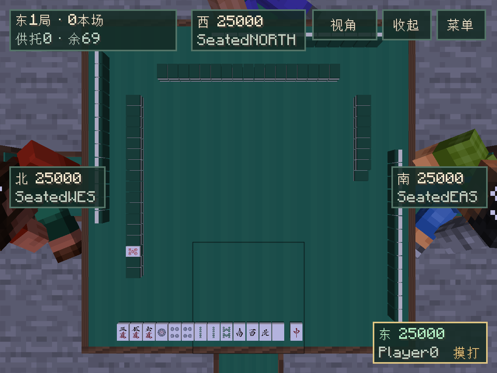

# Riichicraft

面向 **Minecraft Java 26.2 / Fabric** 的日本麻将模组。

从一张能与朋友打麻将的桌子起步，逐步发展为包含自动麻将桌、完整牌具、NPC、特殊结构、独立维度和主线剧情的模组。

## 当前状态

2026-10-20进入 **`0.1.0-dev` 独立地形与群系样板**：新维度 `riichicraft:terrain_test` 使用原版噪声生成，三个真实注册的中性测试群系分别用青柠／橙／淡蓝混凝土标识，群系区域与连续地形独立调节。开启作弊或获得OP2后，用 `/riichicraft terrain enter` 进入、`/riichicraft terrain leave` 返回；请使用独立测试世界。本轮不添加传送门、植物、建筑、NPC或剧情，保留已有麻将玩法。已通过三固定种子正常重开与反序生成、实际生存往返和原有麻将联机回归。参数、截图与边界见[地形样板](docs/TERRAIN_PROTOTYPE.md)。

2026-10-20的 **`0.0.20-dev` 整理存档协调职责**：保存状态、失败处理、损坏保护和停服后写入限制集中维护，大厅服务继续负责运行中的桌子与玩家。开发阶段不以历史测试版存档兼容为目标，不新增迁移逻辑。范围与验证见[存档协调](docs/PERSISTENCE_COORDINATION.md)。

2026-10-20的 **`0.0.19-dev` 提取服务端快照转换**：三／四麻的私人视图、动作列表、结算和临时等待显示集中在纯转换类，服务继续负责身份、在场、规则动作和生命周期。19个真实核心轨迹的416份原v18网络包逐字节一致，规则、协议和存档格式沿用。范围与验证见[服务端快照转换](docs/SERVER_PROJECTION.md)。

2026-10-20的 **`0.0.18-dev` 提取新旧界面共用的展示转换**：结算摘要、番符／役、支付、供托、排名及动作标签集中维护。旧界面保留累计点差，大桌保留本小局点差，布局和操作沿用；48组原v17结算与11组动作样本逐行保护显示一致性。范围与验证见[共用展示](docs/SHARED_PRESENTATION.md)。

2026-10-19的 **`0.0.17-dev` 修复全面审计确认的四项问题**：三麻连续拔北后可继续正常操作；回大厅释放真正缺席的座位；操作层隐藏时Esc也能退出俯瞰；可见手牌从实际原位置打出、鸣走或整理。先提取统一回大厅转换与客户端私手动画职责，没有重写整套状态机。实现与兼容保护见[审计修复](docs/AUDIT_FIXES.md)，原始发现见[全面审计](docs/CODE_AUDIT.md)。

此前 **`0.0.16-dev` 的试玩修复继续保留**：摸牌与补牌不提前闪现，结算分页防止负索引崩溃，Esc收起时回坐姿，立直和牌展示真实里宝指示牌；无人可响应的弃牌有25%概率出现0.2～2秒等待，短等待更常见，使用全桌统一提示。历史实现见[试玩修复](docs/PLAYTEST_FIXES.md)。客户端和服务器需一并更新；网络和存档格式未变，另有14份由原v16生产JAR生成的固定旧档回归。

`0.0.15-dev`的生存合成继续保留：大桌、普通麻将椅、普通椅转空椅、空椅还原均可通过原版合成与配方书获取。使用任意木板、铁锭、木棍及原版绿色羊毛／染料；一桌四椅共需26木板、2铁锭、5绿色羊毛、8木棍。三麻另用一份灰色染料将其中一椅转为空椅。配方见[生存获取](docs/SURVIVAL_RECIPES.md)，证据见[验证记录](docs/VALIDATION.md)。个性化整体延后至道场阶段。

`0.0.14-dev`的桌面操作完善继续保留：左上显示场风、局数、本场、供托与剩余活牌，各家显示姓名、座风和实时点数；指向／选中本人牌有描边，立直选牌按服务端合法名单高亮。常驻大段说明与终止按钮收进桌边菜单，完整牌河可按需翻阅；顶部与结算改用统一深绿控件，菜单不向背后手牌透传点击。操作见[坐席与桌面操作](docs/IMMERSIVE_TABLE.md)。

`0.0.13-dev`的真实坐席与双视角继续保留：右键普通椅子坐下并参加该侧，准备后由起家开局；自动俯瞰，默认`V`切换坐姿／俯瞰，`R`／`Esc`收起操作以环顾，收起后`Shift`起身。菜单内Esc先关菜单，按键可重绑。直接双击桌上的同一张合法牌出牌，吃碰杠等以手牌旁小按钮和组合牌图操作。离椅保留原身份，只见本人暗手；显式观看者可见全部手牌。结算倒牌，小卡片显示役／番符、账本点差与下一局确认；旧桌与存档兼容沿用。

上一开发版 **`0.0.12-dev` 加入桌面基础动作动画**（本版继续保留）：摸牌、打牌、吃碰、杠／拔北补牌与宝牌翻面采用短促低弧线过渡；每段约0.22～0.26秒。服务器和手牌界面立即更新，不等待演出。连续动作按公开顺序播放，明显积压则收束到最新状态；暂停、终局、重新靠近、重连与正常世界重开均不会补播旧动作。详见[动作动画](docs/TABLE_ANIMATIONS.md)。开局直接显示配好的桌面，洗牌、逐轮配牌、掷骰与角色手臂留后续。

牌墙仍按已确认方案：四麻完整墙每边17墩，三麻三个有人椅位各18墩、空椅侧不排墙。补牌时活牌尾原地划入14张王牌，指示牌在王牌上翻开，不在桌心重复摆。相对桌向固定开口和准确上下层取牌保持不变，详见[牌墙说明](docs/TABLE_WALL.md)。

大桌仍公开显示牌河、副露、三麻拔北与暗手牌背，附近玩家关着界面也能观看。六张一行、立直横牌、鸣牌方向、暗杠盖牌和加杠叠牌均保留；新大桌直接显示本人的桌面手牌，旧桌保留手牌界面。公开同步仅新增活牌数量，隐藏牌序不发客户端，双方更新本版即可显示新墙形。同步与操作见[桌面展示](docs/TABLETOP_DISPLAY.md)。

首套37种许可牌面、乳白牌体与深绿背立体物品和图案手牌均保留，获取及素材来源见[麻将牌说明](docs/MAHJONG_TILES.md)。

已有3×3大麻将桌、麻将椅和“空椅子”，含椅位占地5×5；四椅四麻，三椅加空椅子三麻，全部朝向桌心。布局失效暂停保牌，修复为原人数后全员确认继续；旧单方块桌和牌局保留原入口。摆放、兼容与获取方式见[桌椅说明](docs/TABLE_AND_CHAIRS.md)，实际检查与运行边界以[验证记录](docs/VALIDATION.md)为准。

三麻与四麻均已支持单局、东风、半庄及正常牌局存档恢复。三麻108牌、两赤、主动拔北和抢北，完整操作见[三人麻将](docs/THREE_PLAYER.md)。四麻保留136 张牌含三赤五，私人手牌与公开牌河、吃碰杠、立直、自摸／荣和、流局及点数结算均可通过麻将桌界面操作。行动、牌河和结果支持分页，组合选择保留赤牌差异，食替与立直摸切由服务端限制。小局操作见[四人单局](docs/SINGLE_ROUND.md)，整场流程见[东风／半庄](docs/MATCHES.md)。

大桌人数由椅位决定，旧桌仍由初始东位选择人数；两种桌的赛制均由初始东位选择，改变人数或赛制清空准备，全员准备后开始。四麻新场每家25,000点，起家沿用初始东位。整场每小局结算后四人各自确认继续，保留点数／供托，按规则连庄／轮庄、递增本场、进入延长或最终排名。最终结果保留，任一参与者可带全桌返回大厅并取消准备；重新开场才重置点数。单局模式保留原来一次结算即返回的流程。三麻在旧桌由大厅切换、大桌由三椅加空椅子识别，三人全准备后开始，新场各35,000点，三票续局／恢复；已有四人时不能切三麻，需一人主动离座。当前没有NPC补位。

规则以雀魂普通四麻为基线，允许一炮三响，并如实标明用户直接裁定的边界，包括无役结构完成牌参与振听，以及流局满贯须门清（暗杠允许）。标准形／七对子／国士、役番符、宝牌、振听、抢杠与翻宝、流局及包牌均由独立核心裁决，参赛者只接收本人暗手；显式观战另接收全部暗手，不下发牌墙顺序或种子。详情见[四麻规则表](docs/FOUR_PLAYER_RULES.md)与[独立单局核心](docs/SINGLE_ROUND_CORE.md)。

活动局掉线、死亡、跨维度或离桌过远会暂停保留状态，所有参与者回桌确认后继续。局间缺席清空续局票，返回后重新确认；关闭界面可重开，已结算点数不撤销。正常停服、自动保存与区块卸载会保存牌局；重新加载活动局后，原三人／四人按所选人数回桌确认继续，局间重新投续局票，终场保留结果。有效牌局破桌或主动终止仍清除。损坏档保留并禁止自动覆盖；异常崩溃最多恢复到最近成功保存，详情见[牌局存档](docs/PERSISTENCE.md)。没有长期点数账户。

29套独立测试及101项Minecraft服务端测试通过，新增地形资源定义与三个动态注册群系检查，并保留当前版本保存失败重试、损坏保护、三麻耗尽北等待、返回大厅成员转换及快照转换回归，保留规则、配方、家具、牌墙／动画、三／四麻和正常世界重开检查。真实TCP运行证据与产物见[验证记录](docs/VALIDATION.md)。原三／四麻主流程为**一个真实客户端＋两名／三名原生服务端内存夹具**；旁观为**一个未入座真实客户端＋四名原生夹具**，均不代表真人多人验收。人工视觉与长期操作手感另行验证；接续位置见[SESSION_STATUS.md](docs/SESSION_STATUS.md)。



## 规划入口

- [0.1 独立地形与群系样板](docs/TERRAIN_PROTOTYPE.md)：测试命令、原版生成职责、区域／山高／占比参数与实际验证进度。
- [存档协调](docs/PERSISTENCE_COORDINATION.md)：保存状态、按需检查点及失败／损坏／停服边界。
- [服务端快照转换](docs/SERVER_PROJECTION.md)：纯转换职责、身份边界及416份原版封包对照。
- [新旧界面共用展示](docs/SHARED_PRESENTATION.md)：不可变结算摘要、公共文字转换与原版显示样本对照。
- [审计修复与小步整理](docs/AUDIT_FIXES.md)：四项缺陷、第一步职责提取及固定旧档兼容保护。
- [试玩问题修复](docs/PLAYTEST_FIXES.md)：摸牌同步、结算分页、Esc镜头、里宝公开与响应等待。
- [生存合成与朋友试玩](docs/SURVIVAL_RECIPES.md)：四份配方、配方书解锁、一桌材料与简短联机步骤。
- [坐席、镜头与桌面操作](docs/IMMERSIVE_TABLE.md)：场况与点数、桌边菜单、选牌反馈、坐席双视角、双击出牌、动作与结算、观战全手牌，以及后续外观扩展。
- [完整规划](docs/PLAN.md)：玩法边界、物品、规则、架构、开发阶段及验收。
- [第一个开发步骤](docs/FIRST_STEP.md)：只实现工程与基础麻将桌的具体范围。
- [入座大厅设计](docs/LOBBY.md)：v0.0.2 已确认的交互与验证目标。
- [四人摸打原型](docs/DRAW_DISCARD.md)：v0.0.3 历史范围与活动局暂停方案。
- [四人单局](docs/SINGLE_ROUND.md)：当前游戏操作、分页菜单、结果保留、生命周期与验证边界。
- [四人东风／半庄](docs/MATCHES.md)：赛制选择、四票续局、整场结束、最终排名与验证边界。
- [大桌与椅子](docs/TABLE_AND_CHAIRS.md)：3×3桌体、三／四麻布局识别、暂停修复与旧桌兼容。
- [大桌公开牌面](docs/TABLETOP_DISPLAY.md)：附近无界面旁观、牌河／副露／指示／拔北与暗手牌背。
- [静态牌墙与王牌](docs/TABLE_WALL.md)：三／四麻实体排墙、准确补牌位置、指示归位、公开计数与验证。
- [桌面基础动作](docs/TABLE_ANIMATIONS.md)：短促摸打／鸣牌／补牌／翻宝、公开顺序、快速收束与恢复边界。
- [麻将牌模型与手牌](docs/MAHJONG_TILES.md)：37种外观、深绿背立体物品、图案手牌、素材许可与重建。
- [牌局存档](docs/PERSISTENCE.md)：正常保存／恢复、损坏保护、版本与崩溃边界。
- [四麻规则基线](docs/FOUR_PLAYER_RULES.md)：雀魂官方来源、用户裁定与已实现的规则边界。
- [三麻规则表](docs/THREE_PLAYER_RULES.md)：雀魂三麻基线、已确认裁定、牌山静态来源及动画边界。
- [三麻独立核心](docs/THREE_PLAYER_CORE.md)：108牌、手牌计分、拔北／抢北、真实两家支付、单局／整场及独立归档；游戏操作见[三人麻将](docs/THREE_PLAYER.md)。
- [独立规则核心](docs/RULES_CORE.md)：牌形、计分、振听与各组件的代码契约和验证索引。
- [独立单局引擎](docs/SINGLE_ROUND_CORE.md)：阶段、身份、稳定响应窗、私有视图与守恒。
- [振听与和牌检查](docs/FURITEN.md)：历史状态、无役见逃及指定机会裁决。
- [弃牌响应窗口](docs/DISCARD_RESPONSES.md)：三家收集、动作优先级、多人荣和与重放边界。
- [鸣牌与牌山](docs/CALL_ACTIONS.md)：吃碰明杠的物理选项、食替、手牌执行与活牌／王牌守恒。
- [立直与账本](docs/RIICHI_AND_LEDGER.md)：宣言成立、一发、准确弃牌与小局和牌支付、供托守恒和组件包牌。
- [杠流程](docs/KAN_FLOW.md)：暗杠／加杠选择、抢杠响应与见逃、翻宝、第四杠和组合验证。

当前优先完成0.1地形样板，在真实游戏中观察后按反馈调整；完整地形客户端验证以[地形说明](docs/TERRAIN_PROTOTYPE.md)与[验证记录](docs/VALIDATION.md)的实际结果为准。此前总体路线保留作后续讨论参考：

**基础桌 → 入座大厅 → 摸打原型 → 四人单局 → 四人东风／半庄 → 牌局存档恢复 → 三麻两种赛制 → 首个玩法发布 → 自动桌与生存体验 → NPC 与结构 → 维度与剧情。**

每一阶段分别记录代码验证、Minecraft 实测与玩家体验结果。

## 开发与构建

Windows / PowerShell 7：

```powershell
./tools/Initialize-Dev.ps1
./tools/Check-Resources.ps1
./tools/Invoke-Gradle.ps1 build
```

首次运行会将固定版本 JDK、Gradle 和依赖下载到本项目。后续通过 `Invoke-Gradle.ps1` 使用项目专用环境，避免使用全局 Gradle 缓存。本分支目标产物为 `build/libs/riichicraft-0.1.0-dev.jar`，增加独立地形样板，并保留三麻与四麻、正常存档、实体桌椅及生存合成、牌墙动画和坐席双视角／直接点牌；最终构建与试玩包以验证记录为准，此前检查点保持原位。带 `-sources` 的文件是源码包。v0.0.3历史检查点对应 `riichicraft-0.0.3.jar`。客户端与服务器都需安装同一版本的 Riichicraft 及兼容的 Fabric API；桌面展示需要两端更新到本版本。

只验证独立规则，不启动游戏或 Gradle：

```powershell
./tools/Test-Rules.ps1
```

```powershell
# 自动进入测试世界，验证客户端交互并保存截图
./tools/Invoke-Gradle.ps1 runClientGameTest

# 手动打开开发客户端
./tools/Invoke-Gradle.ps1 runClient
```

生存获取见[配方说明](docs/SURVIVAL_RECIPES.md)。开发客户端也可从创造模式功能方块分类获取桌椅，或用下列命令：

```mcfunction
give @s riichicraft:large_mahjong_table
give @s riichicraft:mahjong_chair 4
give @s riichicraft:empty_chair
```

大桌点地面放置完整3×3桌体，周围四边各放一把朝桌心的椅子；三麻将其中一把换成空椅子。旧桌仍用 `/give @s riichicraft:mahjong_table` 获取。普通右键打开大厅、自动入座；初始东位选择单局／东风／半庄，对应人数全部准备后由其点击“开始对局”。三麻拔北位于“行动选项”菜单，公开显示拔北数。潜行保留原版使用手持物品的行为，同一玩家只能占一桌。具体鸣牌、立直与结算操作见[四人单局](docs/SINGLE_ROUND.md)和[整场说明](docs/MATCHES.md)。

- [开发流程与工具链](docs/DEVELOPMENT.md)
- [资源来源与重建](docs/ASSETS.md)
- 项目协作与文件访问约束见 [AGENTS.md](AGENTS.md)。
