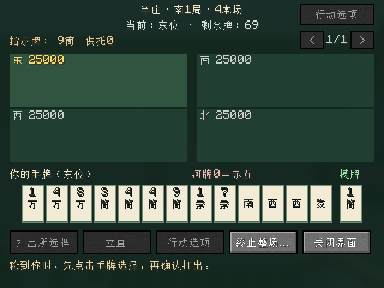

# Riichicraft

面向 **Minecraft Java 26.2 / Fabric** 的日本麻将模组。

从一张能与朋友打麻将的桌子起步，逐步发展为包含自动麻将桌、完整牌具、NPC、特殊结构、独立维度和主线剧情的模组。

## 当前状态

当前开发版本 **`0.0.8-dev` 加入3×3大麻将桌、麻将椅和“空椅子”**，含椅位占地5×5；四椅四麻，三椅加空椅子三麻，全部朝向桌心。布局失效暂停保牌，修复为原人数后全员确认继续；旧单方块桌和牌局保留原入口。摆放、兼容与获取方式见[桌椅说明](docs/TABLE_AND_CHAIRS.md)，实际检查与运行边界以[验证记录](docs/VALIDATION.md)为准。

三麻与四麻均已支持单局、东风、半庄及正常牌局存档恢复。三麻108牌、两赤、主动拔北和抢北，完整操作见[三人麻将](docs/THREE_PLAYER.md)。四麻保留136 张牌含三赤五，私人手牌与公开牌河、吃碰杠、立直、自摸／荣和、流局及点数结算均可通过麻将桌界面操作。行动、牌河和结果支持分页，组合选择保留赤牌差异，食替与立直摸切由服务端限制。小局操作见[四人单局](docs/SINGLE_ROUND.md)，整场流程见[东风／半庄](docs/MATCHES.md)。

大桌人数由椅位决定，旧桌仍由初始东位选择人数；两种桌的赛制均由初始东位选择，改变人数或赛制清空准备，全员准备后开始。四麻新场每家25,000点，起家沿用初始东位。整场每小局结算后四人各自确认继续，保留点数／供托，按规则连庄／轮庄、递增本场、进入延长或最终排名。最终结果保留，任一参与者可带全桌返回大厅并取消准备；重新开场才重置点数。单局模式保留原来一次结算即返回的流程。三麻在旧桌由大厅切换、大桌由三椅加空椅子识别，三人全准备后开始，新场各35,000点，三票续局／恢复；已有四人时不能切三麻，需一人主动离座。当前没有NPC补位。

规则以雀魂普通四麻为基线，允许一炮三响，并如实标明用户直接裁定的边界，包括无役结构完成牌参与振听，以及流局满贯须门清（暗杠允许）。标准形／七对子／国士、役番符、宝牌、振听、抢杠与翻宝、流局及包牌均由独立核心裁决，服务端只发送本人私手和公开信息。详情见[四麻规则表](docs/FOUR_PLAYER_RULES.md)与[独立单局核心](docs/SINGLE_ROUND_CORE.md)。

活动局掉线、死亡、跨维度或离桌过远会暂停保留状态，所有参与者回桌确认后继续。局间缺席清空续局票，返回后重新确认；关闭界面可重开，已结算点数不撤销。正常停服、自动保存与区块卸载会保存牌局；重新加载活动局后，原三人／四人按所选人数回桌确认继续，局间重新投续局票，终场保留结果。有效牌局破桌或主动终止仍清除。损坏档保留并禁止自动覆盖；异常崩溃最多恢复到最近成功保存，详情见[牌局存档](docs/PERSISTENCE.md)。没有长期点数账户。

23套独立规则测试及60项Minecraft服务端测试通过，包含新增家具、三麻与原四麻／存档回归；最新TCP与计数以验证记录为准。真实TCP已覆盖完整三麻／四麻东风与半庄，以及同世界正常停服、由新专用服务器实例恢复牌局；三麻另验证已成立拔北、私手、牌山和三票恢复。核心归档另通过全新Java进程读写验证。证据与产物见[验证记录](docs/VALIDATION.md)。TCP配置为**一个真实客户端，另两名（三麻）或三名（四麻）原生服务端内存夹具**，长摸打轨迹由服务端受控合法动作推进，不代表四真人验收。人工视觉与长期操作手感另行验证；接续位置见[SESSION_STATUS.md](docs/SESSION_STATUS.md)。



## 规划入口

- [完整规划](docs/PLAN.md)：玩法边界、物品、规则、架构、开发阶段及验收。
- [第一个开发步骤](docs/FIRST_STEP.md)：只实现工程与基础麻将桌的具体范围。
- [入座大厅设计](docs/LOBBY.md)：v0.0.2 已确认的交互与验证目标。
- [四人摸打原型](docs/DRAW_DISCARD.md)：v0.0.3 历史范围与活动局暂停方案。
- [四人单局](docs/SINGLE_ROUND.md)：当前游戏操作、分页菜单、结果保留、生命周期与验证边界。
- [四人东风／半庄](docs/MATCHES.md)：赛制选择、四票续局、整场结束、最终排名与验证边界。
- [大桌与椅子](docs/TABLE_AND_CHAIRS.md)：3×3桌体、三／四麻布局识别、暂停修复与旧桌兼容。
- [牌局存档](docs/PERSISTENCE.md)：正常保存／恢复、损坏保护、版本与崩溃边界。
- [四麻规则基线](docs/FOUR_PLAYER_RULES.md)：雀魂官方来源、用户裁定与已实现的规则边界。
- [三麻规则表](docs/THREE_PLAYER_RULES.md)：雀魂三麻基线、已确认裁定、牌山静态来源及动画边界。
- [三麻独立核心](docs/THREE_PLAYER_CORE.md)：108牌、手牌计分、拔北／抢北、真实两家支付、单局／整场及独立归档；游戏操作见[三人麻将](docs/THREE_PLAYER.md)。
- [独立规则核心](docs/RULES_CORE.md)：牌形、计分、振听与各组件的代码契约和验证索引。
- [独立单局引擎](docs/SINGLE_ROUND_CORE.md)：阶段、身份、稳定响应窗、私有视图与守恒。
- [振听与和牌检查](docs/FURITEN.md)：历史状态、无役见逃及指定机会裁决。
- [弃牌响应窗口](docs/DISCARD_RESPONSES.md)：三家收集、动作优先级、多人荣和与重放边界。
- [鸣牌与牌山](docs/CALL_ACTIONS.md)：吃碰明杠的物理选项、食替、手牌执行与活牌／王牌守恒。
- [立直与账本](docs/RIICHI_AND_LEDGER.md)：宣言成立、一发、准确弃牌与小局和牌支付、供托守恒和组件包牌。
- [杠流程](docs/KAN_FLOW.md)：暗杠／加杠选择、抢杠响应与见逃、翻宝、第四杠和组合验证。

推荐顺序：

**基础桌 → 入座大厅 → 摸打原型 → 四人单局 → 四人东风／半庄 → 牌局存档恢复 → 三麻两种赛制 → 首个玩法发布 → 自动桌与生存体验 → NPC 与结构 → 维度与剧情。**

每一阶段分别记录代码验证、Minecraft 实测与玩家体验结果。

## 开发与构建

Windows / PowerShell 7：

```powershell
./tools/Initialize-Dev.ps1
./tools/Check-Resources.ps1
./tools/Invoke-Gradle.ps1 build
```

首次运行会将固定版本 JDK、Gradle 和依赖下载到本项目。后续通过 `Invoke-Gradle.ps1` 使用项目专用环境，避免使用全局 Gradle 缓存。当前开发产物为 `build/libs/riichicraft-0.0.7-dev.jar`，已支持三麻与四麻；上一个四麻存档检查点`v0.0.6-dev`保持原位。带 `-sources` 的文件是源码包。v0.0.3历史检查点对应 `riichicraft-0.0.3.jar`。客户端与服务器都需安装同一版本的 Riichicraft 及兼容的 Fabric API；不同版本的网络协议不兼容。

只验证独立规则，不启动游戏或 Gradle：

```powershell
./tools/Test-Rules.ps1
```

```powershell
# 自动进入测试世界，验证客户端交互并保存截图
./tools/Invoke-Gradle.ps1 runClientGameTest

# 手动打开开发客户端
./tools/Invoke-Gradle.ps1 runClient
```

开发客户端可以从创造模式功能方块分类获取桌椅，或用下列命令：

```mcfunction
give @s riichicraft:large_mahjong_table
give @s riichicraft:mahjong_chair 4
give @s riichicraft:empty_chair
```

大桌点地面放置完整3×3桌体，周围四边各放一把朝桌心的椅子；三麻将其中一把换成空椅子。旧桌仍用 `/give @s riichicraft:mahjong_table` 获取。普通右键打开大厅、自动入座；初始东位选择单局／东风／半庄，对应人数全部准备后由其点击“开始对局”。三麻拔北位于“行动选项”菜单，公开显示拔北数。潜行保留原版使用手持物品的行为，同一玩家只能占一桌。具体鸣牌、立直与结算操作见[四人单局](docs/SINGLE_ROUND.md)和[整场说明](docs/MATCHES.md)。

- [开发流程与工具链](docs/DEVELOPMENT.md)
- [资源来源与重建](docs/ASSETS.md)
- 项目协作与文件访问约束见 [AGENTS.md](AGENTS.md)。
