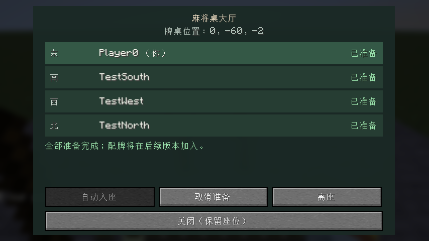

# Riichicraft

面向 **Minecraft Java 26.2 / Fabric** 的日本麻将模组。

从一张能与朋友打麻将的桌子起步，逐步发展为包含自动麻将桌、完整牌具、NPC、特殊结构、独立维度和主线剧情的模组。

## 当前状态

稳定检查点为 `v0.0.2` 入座大厅，已推送 GitHub。当前分支正在开发 `0.0.3-dev` 四人摸打原型：136 张牌含三赤五、东位开局、私人手牌、四家牌河、选牌后确认出牌和自动摸牌已实现，正常路径已自动验证。

运行中的暂停、断线重连、继续和终止策略仍待用户确认并接入，本分支尚不作为 v0.0.3 交付；当前不包含吃碰杠、立直、和牌或计分。详情见[摸打步骤](docs/DRAW_DISCARD.md)。

已恢复开发，检查点见[接续记录](docs/SESSION_STATUS.md)；构建、服务端和客户端的实际结果见[验证记录](docs/VALIDATION.md)。

已确定：

- 名称：Riichicraft；模组 ID 采用 `riichicraft`。
- 目标平台：Minecraft Java 26.2 / Fabric。
- 初期功能目标：三人／四人，东风战／半庄战。
- 交互方式：实体麻将桌＋手牌操作界面，优先保证清楚易用。
- 长期方向：独立维度、特殊结构与主线剧情。

## 规划入口

- [完整规划](docs/PLAN.md)：玩法边界、物品、规则、架构、开发阶段及验收。
- [第一个开发步骤](docs/FIRST_STEP.md)：只实现工程与基础麻将桌的具体范围。
- [入座大厅设计](docs/LOBBY.md)：v0.0.2 已确认的交互与验证目标。
- [四人摸打原型](docs/DRAW_DISCARD.md)：已确认范围、实际进度和待决定的生命周期。

推荐顺序：

**基础桌 → 入座大厅 → 摸打原型 → 四人单局 → 四人东风 → 四人半庄 → 三麻两种赛制 → 首个玩法发布 → 自动桌与生存体验 → NPC 与结构 → 维度与剧情。**

每一阶段分别记录代码验证、Minecraft 实测与玩家体验结果。

## 开发与构建

Windows / PowerShell 7：

```powershell
./tools/Initialize-Dev.ps1
./tools/Check-Resources.ps1
./tools/Invoke-Gradle.ps1 build
```

首次运行会将固定版本 JDK、Gradle 和依赖下载到本项目。后续通过 `Invoke-Gradle.ps1` 使用项目专用环境，避免使用全局 Gradle 缓存。当前开发产物为 `build/libs/riichicraft-0.0.3-dev.jar`，带 `-sources` 的文件是源码包。稳定大厅版本在 `v0.0.2` 标签。

```powershell
# 自动进入测试世界，验证客户端交互并保存截图
./tools/Invoke-Gradle.ps1 runClientGameTest

# 手动打开开发客户端
./tools/Invoke-Gradle.ps1 runClient
```

开发客户端里可以使用 `/give @s riichicraft:mahjong_table` 获得桌子，也可以在创造模式的功能方块分类中找到它。普通右键打开大厅，再点击“自动入座”；潜行保留原版使用手持物品的行为。同一玩家只能占一桌，暂不提供坐姿动画和生存配方。未开局大厅为临时状态，桌子破坏、区块卸载或服务器停止时清理。



- [开发流程与工具链](docs/DEVELOPMENT.md)
- [资源来源与重建](docs/ASSETS.md)
- 项目协作与文件访问约束见 [AGENTS.md](AGENTS.md)。
