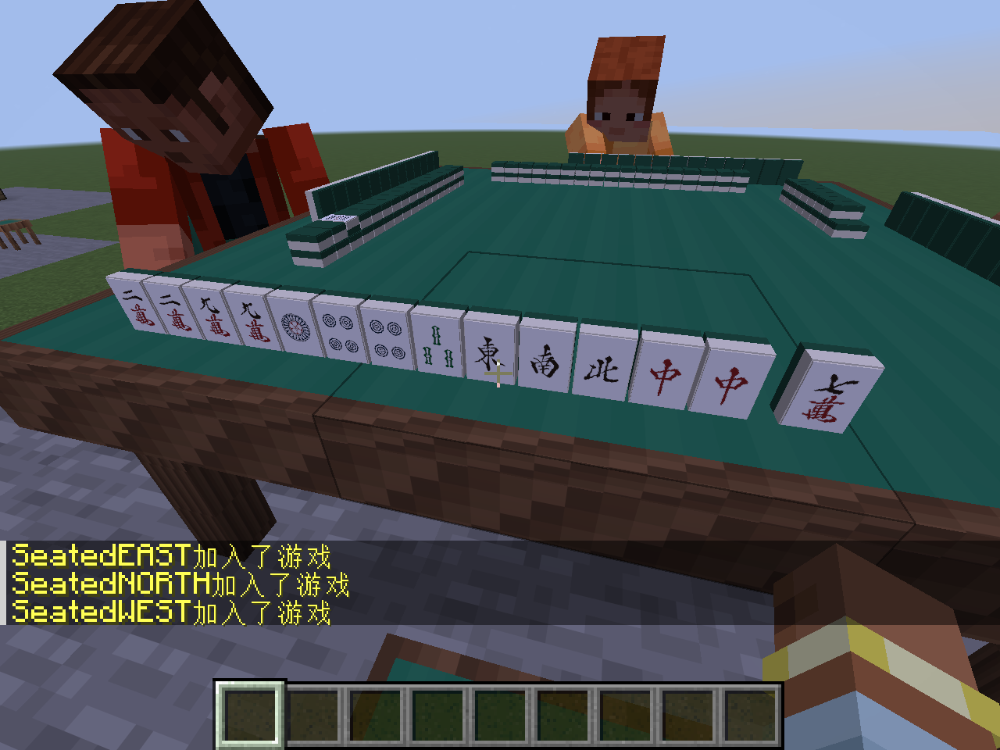

# 审计问题修复与第一步整理

日期：2026-10-19，开发版 `0.0.17-dev`。从[全面审计](CODE_AUDIT.md)的 `51e06b0` 检查点继续，按 A1、A2、A3、A4 处理，并先固定旧版档案再为后续重构建立兼容检查。

后续`0.0.18-dev`已继续提取新旧界面共用的结算摘要与文字转换，保持本页修复，见[共用展示](SHARED_PRESENTATION.md)。本页产物与验证保留为v17历史记录。

## 本轮改变

### A1：合法三麻立直状态可以继续

立直北单骑后连续拔完其余三北，手内与拔北区合计自持四北，当前可用等待可以为空。操作查询现在将这种状态与真正没有结构等待的非法输入区分开，继续提供正常摸切选项。

空的可用等待也不能让非法暗杠通过。此时另行比较杠前后的原结构等待及自持枚数：保留等待的暗杠仍允许，破坏原听牌结构的暗杠仍拒绝。没有改变“立直只拔新摸北”、送杠限制或荒牌不能求第五枚的规则。

新回归使用完整108张实体牌墙，各跑单局、东风、半庄的无杠／合法暗杠／破坏性暗杠三组轨迹，共9条。它们从真实立直开始，经过三次拔北、后续摸切、中途恢复直到荒牌，并核对罚符、供托和整场续局。第一次弱修复被破坏性暗杠负例抓住后已补足，保留失败证据，不用“没有再抛异常”代替规则正确性。

### A2：返回大厅统一执行成员清理

主动终止和最终结果返回共用 `LobbyService.returnToLobby`。转换只发生一次，释放真正离线的身份，以及实体桌上已无有效原椅乘坐的身份；仍坐在正常椅子上的玩家保留座位。旧桌在线玩家仅关闭界面仍保座。

成员清理完成后统一取消准备、广播并保存，终止通知保持原行为。旧牌局请求不会改变大厅或终止新牌局。6项原生测试包含16条三／四麻组合，覆盖原审计六分支、初始东位缺席后由新人补位开局、同tick离椅、正常关闭操作层、旧桌兼容和实际归档清理。

这是本轮第一步职责提取，未合并整套规则状态机或重写服务端所有权管理。

### A3：隐藏操作层也能用 Esc 退出俯瞰

客户端在本窗口收到真实按下事件、当前没有界面或覆盖层且桌面俯瞰有效时，先消费 Esc 并退出俯瞰。座位与牌局身份保留；再按一次 Esc 仍打开原版暂停菜单。聊天和已有菜单继续走原有输入处理。

该处理仅在客户端注册，不引入新依赖，也不将客户端类交给专用服务器加载。



上图来自本轮真实TCP客户端；其他座位为原生服务端夹具。图像只记录Esc后的实际视角，不用静态截图证明动画或真人多人手感。

### A4：可见实体牌从自己的原位置开始移动

公开动画继续使用匿名暗手槽位，客户端另保存最多32个已授权的私有局面。根据公开动画前后状态匹配实体牌及位置，纠正本人／已授权观战者看得到的弃牌、鸣牌与余牌整理来源；补牌仍从原来的真实牌墙／岭上位置取出。

本地插值元数据不发送网络、不进入存档。私有消息先到时显示匹配的旧手牌；公开消息先到时避免同一实体在手牌和公开区域重复，并保留已知仍在手中的副本，直到私有端点到达。连续动作按各自历史匹配，进入新视图／换身份／新局／断线或换世界会清理历史；历史不足时安全回退原公开演出。

独立复核补出了公开消息先到的遗漏：旧摸牌会被防闪条件误当作未来新摸牌隐藏。8动作×4时点原有20个失败；现在保守保留已对应公共状态、仍未离手的已知牌，未知补牌身份不猜测。正式帧检查覆盖128个动作／身份／方位组合及排队动作，共25,914断言，包含动画结束但私有消息仍迟到、私有消息先到的有／无历史场景与最终精确归位。这是确定性帧函数检查，不冒称真实网络丢包或真人观感验收。

### T2：恢复测试不再随机寻找关键分支

最终复跑曾在既有部分响应恢复测试中失败：最多四次随机发牌仍未找到多人响应窗口，94项中其余93项通过。测试现改固定136张合法牌墙，东家首张舍牌让南家可吃、西家可碰，通过真实服务端出牌／过牌取得部分响应，再进行原有磁盘恢复、身份与四人新确认检查。没有提高重试次数或放宽断言，也没有增加生产状态注入接口。失败日志`final-validation.log`保留，最终成功以`release-validation.log`为准。

## 旧存档保护

14份固定历史档案由校验过的原 `0.0.16-dev` 生产 JAR 写入，包含三／四麻活动局、部分响应、真实和牌、带票局间、整场终局、冻结椅侧的世界容器，以及原来三拔北后查询会抛异常的已接受状态。测试每次只读这些历史字节，不用当前代码重新生成“旧档”。

当前读取器须恢复相同公开／私有摘要，并逐字节重编码一致；部分响应、投票、账本和旧三拔北局的后续操作另有行为断言。生成器校验旧JAR及历史源码blob，禁止写入非空目标目录。详情见[旧档兼容样本](LEGACY_ARCHIVES.md)。

本轮未修改网络载荷或世界／规则档案格式，也未迁移重放指纹。后续再提取 UI 展示转换或规则公共职责时，先保持这套兼容检查通过。

## 验证记录

| 类别 | 实际结果 |
| --- | --- |
| 完整构建／独立规则 | 首轮 `build sourcesJar` 2分34秒成功；29套／5,664,445断言。包含新三麻2,997断言及旧档161断言 |
| 原生服务端 | 首轮94 required／22.23秒通过，包含新增6项成员转换测试 |
| 无游戏依赖运行 | `tools/Test-Rules.ps1`通过，使用空的外部类路径，并加载固定测试资源；不启动Fabric或Minecraft |
| 历史生成器 | 根代理另以旧JAR生成到新的项目临时目录，14个二进制及manifest共15个资源与固定样本逐字节一致 |
| 最终完整回归 | `build sourcesJar runClientGameTest`合计3分36秒成功；29套／5,664,445断言，94 required／20.03秒，25,914正式帧断言及真实TCP全流程通过。日志`release-validation.log` |
| 真实客户端／正常重开 | 实际隐藏操作层V→Esc恢复坐姿保座、第二次Esc暂停；旧三四麻、鼠标／菜单、生存合成、观战及正常停服后另一专用服务器实例重开原世界均通过 |
| 正式包 | JAR899,178字节／527条目；逐一排除74个测试源类型及其内部类，历史资源／生成器均未打包。198个规则class、34个网络／存档class与v16逐字节相同，仅`KanActions.class`为本轮规则修复 |

中间失败与最终日志均保存在项目 `.tmp/audit-fixes/`。新增帧检查是明确的显示输入夹具；真实TCP坐席按键、鼠标和正常世界重开另行验证。未声称完成真人多人长期手感、第三方模组兼容、整机重启、硬崩溃或多桌性能压测。

本轮保持个性化延后道场，不新增机器、世界结构、维度或剧情。下一步在这些修复稳定后，优先共享新旧界面的结果展示转换，再分批整理更大的服务端职责。

## 安装与检查点

生产JAR：`build/libs/riichicraft-0.0.17-dev.jar`，SHA-256：

```text
f849d904421bfab3d7e626af6429fc965fc917dbba3467fea53c45538004ba4c
```

本地试玩包：`build/dist/riichicraft-0.0.17-dev-playtest.zip`，820,607字节，仅含同一JAR、中文说明和校验值；解包哈希核对一致。37种牌面、原素材许可及原生生存配方保留，网络和存档格式不变。客户端与服务器一并替换旧Riichicraft JAR，保留适配26.2的Fabric API，勿同时安装多版。

分支`codex/audit-fixes`；完整提交、固定`v0.0.17-dev`标签与远程状态见[接续记录](SESSION_STATUS.md)。旧标签不移动，不创建GitHub Release。Gradle在最终通过后已停止。
