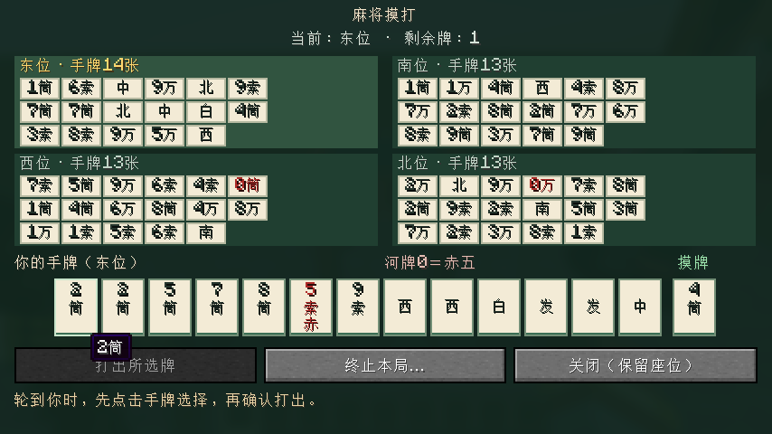
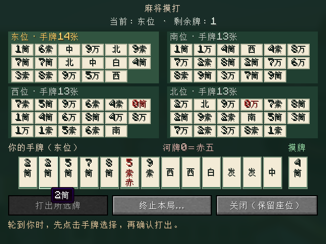
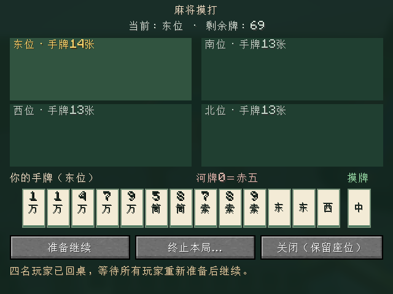

# v0.0.3 四人摸打原型

状态：2026-10-16，v0.0.3 已完成。用户已确认功能范围和临时原型生命周期，服务端实现、33 项 required GameTest 与真实客户端／专用服务器 TCP 检查通过。实际证据和验收边界见 [VALIDATION.md](VALIDATION.md)。

## 已确认的玩家流程

1. 四人按当前大厅流程自动入座并全部准备，由东位点击“开始摸打”。
2. 使用 136 张牌，包含万／筒／索各一张赤五；东位暂作庄家，不进行掷骰或重新排座。
3. 服务器洗牌、给每家配 13 张牌，保留 14 张王牌，再为东位摸一张。庄家首次出牌前 14 张，其余三家 13 张，剩余可摸牌 69 张。
4. 界面显示本人的手牌与摸牌、四家公开牌河、手牌数量、当前出牌者和可摸牌数。
5. 点击手牌进行选择，再点击“确认打出”；服务器裁决成功后，自动为下一家摸牌。
6. 可摸牌耗尽后，最后摸牌的玩家仍可打出该张或其他手牌；完成最后一次出牌后回到大厅，保留座位并取消全员准备，可以重新准备开局。
7. 本版本只验证摸打循环，不包含吃碰杠、立直、和牌、听牌判定或计分。

牌面先由程序绘制清楚的数字／花色与字牌文字，赤五使用明确颜色与标记；完整牌面贴图与世界桌面摆牌后续加入。服务器以唯一牌实例处理动作，同种的两张牌也能准确区分，防止误打或重复提交。

## 数据与验证边界

- 规则核心只依赖 Java，Minecraft 服务端负责玩家、桌子、权限与生命周期。
- 固定种子只用于服务器与自动验证；真实开局种子、隐藏牌山、王牌和他人手牌不发送给客户端。
- 玩家只收到本人手牌；他人仅公开手牌数量与牌河。旁观者不收到任何人的手牌。
- 请求必须绑定玩家、桌子界面、当前原型标识和状态版本；重复、过期、非本人回合与非本人手牌请求不能改变状态。
- 检查从配牌到牌山耗尽全过程的 136 张牌守恒，包含未公开的 14 张王牌；同种牌四张、赤五共三张。
- 静态／核心测试、真实服务端／客户端测试、人工视觉与长期手感分开记录。

## 已确认并实现的临时生命周期

- 已入座参与者掉线、死亡、切换为旁观模式、跨维度或超出牌桌交互范围时暂停本局，保留座位、准确手牌与摸牌、牌河、剩余牌和当前轮次。普通旁观者不参与这些资格判定。
- 四名参与者全部回到可交互状态和桌旁后，逐一点击“准备继续”；第四人确认后恢复。本人已确认时不能重复确认，仍有任何参与者缺席时不能提前确认。
- 任一参与者重新缺席，会清空此前的全部继续确认，必须四人回桌后重新确认。
- 关闭界面仅隐藏视图，不暂停、不离座；重新右键同桌可查看当前状态。
- 正常运行或暂停时，任一参与者都可发起终止。第一次点击仅在本地显示二次确认，点击“确认终止”后才向服务端发送请求；可取消本地确认。
- 牌山耗尽或主动终止后回到大厅，保留原座位并取消全员准备。离线参与者在同一次服务器运行内重连时收到结束通知。
- 桌子破坏、所在区块卸载或服务器停止会终止原型并清理临时状态。没有牌局存档、跨重启恢复或跨重启通知；完整存档恢复仍属于后续阶段。

以上方案已获用户同意并完成实现。

## 已执行验证与实际边界

- 最终完整构建用时 35 秒，33 项 required GameTest 全部通过，涵盖规则核心、服务端裁决及临时生命周期；测试报告耗时 4.361 秒。
- 真实客户端经 TCP 连接本地专用服务器，完整执行配牌到耗尽的摸打循环、320×240 真实按钮点击、活动局断线与重连；准确保留本人手牌、独立摸牌、公开牌河及当前轮次，并通过四人确认继续与本地二次确认终止场景。该轮客户端测试用时约 1 分 9 秒。
- 实测配置是一个真实 Minecraft 客户端，加三名原生 `ServerPlayer`／`EmbeddedChannel` 夹具；不是四名真人或四个真实客户端同时联机。
- 截图已更新如下。自动截图、程序化点击和服务端检查不能代替四真人长期手感或正式启动器安装验收，不将这些人工验收写成已完成。

## 下一阶段

先与用户确认四麻固定规则表，再按小步骤加入和牌与计分。当前阶段不直接开发这些规则，也不把正常摸打原型视作完整日本麻将对局。
