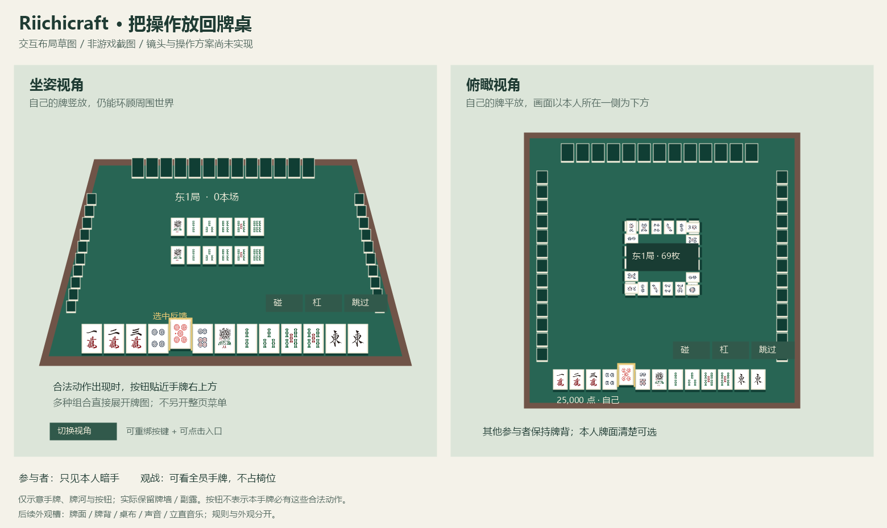

# 坐席、镜头与桌面操作

日期：2026-10-18。状态：**`0.0.14-dev`已接入场况、点数、选牌反馈与桌边菜单**，`0.0.13-dev`的坐席、双视角与直接点牌继续保留。完整执行结果见[验证记录](VALIDATION.md)。设计图不当作游戏截图，自动化不替代人工长期体验。

## 当前操作

1. 摆好3×3大桌与四边朝心的椅子；右键普通椅子实际坐下，并自动参加该侧。空椅子不接受乘坐，右键桌面只观看，不自动抢座。
2. 在桌边小面板选择单局／东风／半庄、准备；所有参与者准备后，固定起家侧的参与者开始。
3. 开局自动俯瞰。**单击选牌，300毫秒内再次点击同一张实体牌直接打出**。立直先按“立直”，再双击合法宣言牌；吃碰杠／和牌／跳过等只在对应合法窗口出现，多个组合展开牌图。
4. `V`切换坐姿与俯瞰。`R`或`Esc`收起操作层以自由环顾，`R`重新打开；收起后按原版`Shift`起身。按键可在Minecraft设置中重绑。操作层中`T`和`/`能打开聊天，打字不出牌、不触发视角快捷键。
5. 局中起身暂停并保留原参赛身份；仍只见本人暗手与公共牌，回原椅后全部原参与者确认恢复。原第一／第三人称在离椅或会话清理时恢复。
6. 结算倒牌、保留牌河；小卡片分页显示役、番符、支付及整小局点差。点差包含已成立立直的1,000点扣棒，以及实际支付／供托和最终余棒分配；立直宣言被荣和、尚未成立则不扣。整场局间按“继续下一局”，全部原参与者确认才推进；单局结束或整场最终结束显示“返回大厅”。

## 场况与桌边菜单（0.0.14）

- 左上显示场风／局数、本场、供托棒数及剩余活牌；各家点数牌按当前物理侧排列，姓名过长时可悬停查看。金边标记当前行动家，另标立直或缺席；正常坐姿下点数牌避开本人手牌区域。
- 视角、收起与菜单使用统一深绿半透明控件。按键提示读取当前绑定；操作说明移入菜单，底部只在选中、立直选牌或等待服务器时显示相关信息。
- 悬停描边并放大本人牌，单击后金色选中；立直模式的绿色描边严格来自当前服务端宣言牌列表，不推测听牌或役。其他牌仍可查看，不能用于宣言。
- 菜单提供分页操作说明、完整舍牌历史和二次终止。历史保留物理赤牌、立直宣言、摸切和被鸣去向，不用桌面移走后的牌反推历史。取消终止不发送请求；菜单、禁用按钮及点数牌不向背后手牌透传点击，菜单中断或缩放后需重新完成双击。
- 菜单内按Esc先关菜单；再次按Esc沿用收起操作层的行为。响应按钮只在菜单关闭后操作，菜单不会代玩家跳过响应。新小局到来自动收起旧菜单。
- 结算时收起局中点数牌并压窄顶部操作条，让倒牌更清楚；最终余棒归属后的点数仍以整场排名中的真实值为准。小结算卡继续提供役／番符、支付与下一局确认。

本步只完善既有客户端交互，不改变麻将规则、网络载荷、存档格式或依赖。可选外观、解锁档案、立直音乐库仍属后续方向。最终原生图：[俯瞰](images/table-ui-overhead.png)、[坐姿](images/table-ui-seated.png)、[倒牌结算](images/table-ui-result.png)、[按需帮助](images/table-ui-help.png)、[完整牌河](images/table-ui-history.png)、[三麻正常重开](images/table-ui-restored.png)。另有[立直掩码界面夹具](images/table-ui-riichi-mask-fixture.png)：在真实桌面上替换客户端合法列表，仅验证描边与输入隔离，不冒称该随机起手实际可立直。恢复截图仍含测试离线身份的原生通知，未改绘。

显式观看者不占椅、不投票、没有出牌按钮，可看全部手牌并切换俯瞰。普通靠近但没有进入观看视图的玩家仍接收原公开桌面。本人临时离椅不会被换成全手牌观战身份。

默认牌背、牌面和桌布沿用现有资源；本版加入轻量原版坐席／牌声／开局与结算提示，不重播重连前的声音。每桌可选皮肤、解锁档案、立直音乐库和剧情道场尚未接入，外观扩展设计保留在本页后半部分。

旧单方块桌保留原GUI。旧大桌牌局和原视图接口可继续读取；新椅子流程采用实际物理侧。世界容器升级到v2保存冻结椅侧，兼容读取v1；坐席实体本身不落盘。客户端与服务端均须更新到本版，升级后写出的v2世界记录不能由旧版读取。

## 用户已经确定的方向

0.0.13首批历史实机画面：[俯瞰本人手牌](images/immersive-overhead.png)、[坐姿竖牌](images/immersive-seated.png)、[显式观战全手牌](images/immersive-spectator.png)、[倒牌与小结算卡](images/immersive-result.png)、[正常世界重开恢复](images/immersive-restored.png)。均为原生客户端运行，夹具身份通知仅在测试截图前清理，不对图片改绘；恢复截图对应独立三麻场景。截图不代表真人多人长期验收。

- 坐在椅子上即参与对应麻将桌；桌子和椅子应能实际交互。
- 玩家可在正常坐姿与俯瞰间自行切换。坐姿时本人的桌面手牌竖放，俯瞰时本人手牌平放并朝自己，便于看清。
- 开始自动俯瞰；结算倒牌并展示小型结果UI，镜头以看清倒牌为准。离椅不转成观战身份。
- 参与者看到自己的手牌，其他参与者的暗手显示牌背。**观战者可以看全部参与者手牌**，用户明确接受观战泄密，不设计额外反串通机制。这是对先前“旁观也只看牌背”的方向调整。
- 吃、碰、杠等放在手牌区域右上方的小按钮，多个组合直接展开牌图，不再跳进整页“行动选项”。
- 逐步加入轻量音效；未来道场／特殊结构可解锁牌背、牌面、桌面和立直音乐。当前只预留外观边界，解锁条件、剧情和音乐素材另行设计。

## 三项交互决定

| 项目 | 当前方案 | 确认状态 |
| --- | --- | --- |
| 入座与开局 | 右键哪把普通椅子，就坐在该侧并自动加入；起家位置相对桌向固定，轮庄不换椅子。仍需准备，全员准备后起家点开始 | **用户已确认** |
| 离椅与镜头 | 未开局起身释放；活动局起身暂停保留原座，仍只见本人暗手和公共牌。回原椅后全员确认。每小局开始俯瞰，结算倒牌并展示结果；可随时切换，离桌恢复此前第一／第三人称 | **用户已确认离椅可见范围及结算倒牌；沿用暂停保留边界** |
| 出牌 | 单击选中，双击同一张合法牌直接打出；立直先点小按钮再双击合法宣言牌 | **用户已确认双击出牌** |

点击普通椅子即可选中物理座位，无需再打开大厅点“加入”。“空椅子”仍是三麻结构标记，不可乘坐或加入。世界方位与牌局座风不等同：起家沿桌向确定，三麻跳过空椅，之后按既有规则轮庄，不搬动玩家。

## 初始操作画面草图（历史设计）

上图用于说明布局：手牌是桌面上可选中的牌，动作按钮靠近本人手牌右上方；不再用一整页文字牌河遮住桌面，也不在底部重复另一套完整手牌。牌面沿用当前许可图案。具体镜头高度、字号和按钮间距要在真实客户端中调整，不能用设计图验收。

- 鼠标指向手牌时抬起／描边，选中后保留清晰反馈。非本人回合仍能查看牌，不能提交非法弃牌。
- 合法动作出现时才显示对应按钮；“荣和／自摸”有明确文字。响应窗口始终有“跳过”。没有合法动作时不留一整排灰按钮。
- 有多个吃或杠组合时，在手牌上方展开一小排候选牌图；赤牌与普通五的选择必须保留，取消组合不等于跳过响应。
- 立直先进入弃牌选择，只高亮服务端允许的宣言牌；确认后仍走原有宣言牌荣和／扣棒流程。
- 场风、局数、本场、供托和剩余牌用紧凑场况条；点数放在相应玩家附近。役、符、番、支付明细在结算卡片中查看。
- 准备、开始、恢复、续局等按当前状态出现。赛制设置、二次终止和查看完整舍牌历史／结果放在小型桌边菜单，不混在每巡动作中。
- 镜头切换与鼠标控制有可重绑按键，并有可点击入口；聊天、Esc、暂停菜单不得提交出牌或直接退出牌局。打开聊天时暂停手牌快捷键，关闭后恢复。
- 低分辨率／较大界面缩放保留看清手牌的放大方式和完整动作入口，不能将关键按钮挤出屏幕。无须一直占用大窗口。

## 镜头、牌姿与观战

坐姿使用椅子上的玩家位置，允许环顾世界；俯瞰是客户端围绕桌心、以本人一侧在画面下方的固定麻将镜头，**不会把玩家传送到空中或切成旁观游戏模式**。镜头和鼠标操作分离：环顾时保留 Minecraft 操作，操作手牌时释放光标；切换入口需始终可见。

本人的竖放／平放是该客户端的显示选择，不让另一名玩家切镜头时把全桌手牌一起翻过来。公共牌河、副露、牌墙与现有动画继续共用准确坐标；参与者的其他家暗手保持牌背。完整牌墙顺序、随机种子和未公开指示牌无需因开放观战而发送。

旁观者通过桌子进入观战视图，不占普通椅子，不加入准备／恢复／续局票；该视图可显示全部手牌并切换观察方向。观战没有打牌按钮。参加本桌的玩家即使临时起身，也仍按原参与者身份处理，不能因镜头模式改变座位和控制权限。这里区分身份是为了操作正确，不增加旁观防泄密系统。

镜头退出路径必须统一清理：离桌、换维度、死亡、断线、破桌、桌子卸载、切换世界等都不能遗留锁定镜头或鼠标。恢复存档时不自动重新挂乘坐实体；按原身份回椅后继续，规则局面与已结算点数仍按现有存档边界处理。

## 分步接入

| 步骤 | 可检验的交付 | 保留的兼容入口 |
| --- | --- | --- |
| 1. 实际坐席 | 普通椅子可坐、点击位置对应参与侧、占座冲突原子处理；准备／开局与离椅暂停接入，三麻空椅不误入 | 旧单方块桌继续原界面；已有牌局按原座位映射恢复 |
| 2. 镜头与可见手牌 | 自动开始／结束镜头、手动切换、本人牌姿及观战全部手牌；离开与重连正确清理 | 改造期间保留主动打开旧界面的调试入口，不抢占新视图 |
| 3. 桌面直接操作 | 世界手牌选中、紧凑合法动作按钮、组合牌图、立直选牌与结算卡片；新入口成为大桌默认操作 | 旧桌继续可玩；完整明细可按需打开 |
| 4. 声音与外观接口 | 基础牌声／坐席提示、声音去重、可独立调音；默认外观通过统一配置解析，预留款式ID | 只携带默认款，不假称已实现道场解锁或音乐收藏 |

每步可单独提交，但不能把仅能坐下称为已完成沉浸式操作。新增玩法方向及离椅可见范围、结算倒牌、双击出牌均已确定；视觉参数、内部类拆分和可自动执行的验证不反复询问。

## 外观扩展：现在已有与需要补的部分

当前37种牌面共用`body.json`牌体，通过`face`、`back`、`ivory`引用材质；`TileAppearance`集中把牌ID映射为资源。桌体也已分开`wood`和`cloth`材质。因此**替换整包默认牌背／牌面／桌布较容易，不需要重写规则**。但资源路径和部分UI颜色仍写在代码／模型里，尚不支持每桌不同款式，也没有解锁档案。

建议外观由稳定ID及定义组成，以下为接口草案，不是已经上线的配置格式：

| 外观槽 | 独立内容 | 后续例子 |
| --- | --- | --- |
| 牌面套组 | 34普通牌＋3赤五的图案、名称和预览 | 道场专属字体／纹样 |
| 牌背与牌体 | 背面图案、颜色、牌体材质；沿用同一尺寸起步 | 深绿、木纹、剧情徽记 |
| 桌布与桌框 | 桌面材质、颜色和配套框材 | 雀庄绿布、道场纹章 |
| 声音套组 | 摸打／鸣牌等声音事件、音量类别 | 木牌声、自动桌声 |
| 立直音乐 | 音轨、播放与停止规则、音量 | 剧情解锁曲目 |

默认款可以使用`riichicraft:classic_green`等稳定标识；规则中的牌种、赤牌、点数和合法动作保持原样。世界桌面、手牌放大图、预览和动画走同一个外观解析入口，渲染缓存必须包含款式ID，不能让换桌后继续复用上一套牌背。

桌布是九个方块拼出的3×3面：整包资源替换已可行；**每桌单独选皮肤还需要按桌绑定的渲染／资源解析**，不能只改一张全局PNG就称为支持。只存外观ID与选择，缺失资源回落默认，不让旧世界因款式移除而无法开局。新定义应先校验完整37牌映射及本地引用。

多人共享桌面选谁的款式、各人能否选择自己看到的牌面、立直音乐听众范围，留到首个可选款式接入前确认。当前无需决定解锁条件或创建空白的剧情系统。后续解锁只改变可选外观与持久化进度，不改麻将规则；解锁来源仍需与道场／剧情阶段一起设计。

首批音效可复用适合的原版声音或新增项目原创／明确许可素材；不随意下载音乐。音效与牌桌状态分离，迟到、重连和重复快照不重播历史声音，游戏裁决不等待声音结束。

## 验证要求

实施后应覆盖：同椅并发入座、不同桌重复占座、四朝向与三麻四种空椅位置、初始座与轮庄映射、被占椅／空椅拒绝、离椅暂停及回椅确认、破椅／破桌／死亡／跨维度清理；保留旧桌和旧存档兼容。

客户端实际检查第一／第三人称恢复、坐姿／俯瞰切换、参与者与观战者牌面差异、鼠标射线只选本人牌、红五组合、过期响应拒绝、聊天／Esc、不同尺寸与UI缩放、镜头退出无残留。声音按已接受动作去重。正常保存／重开必须用真实世界回归，编译不能替代。

自动化可证明动作与生命周期正确；镜头舒适度、读牌清晰度、音量与长期操作手感仍需要人工验收。必要时只提供一份短验收清单，不在每个内部验证步骤打断用户。
