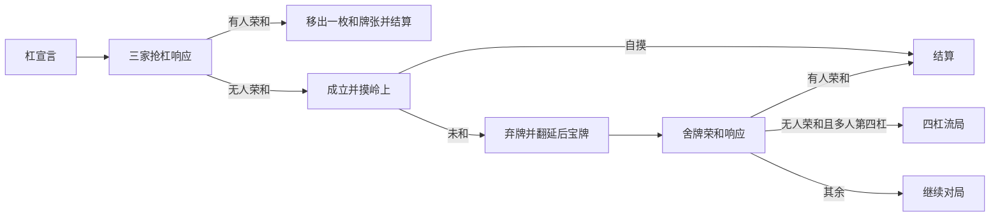

# 独立暗杠、加杠与抢杠流程

版本：`0.0.4-dev`。新增 `KanActions`、`KanResponseWindow`、`KanRoundState`，扩展见逃跟踪和小局账本。它们与已有牌山、计分、舍牌响应等组件组合验证；尚不是统一对局引擎，未接入 Minecraft 新按钮。

## 来源与用户裁定

[雀魂官方段位规则](https://mahjongsoul.com/news/46)与 [FAQ](https://mahjongsoul.com/faq) 已说明可抢加杠、暗杠仅国士能抢、抢杠见逃振听、暗杠即翻／明杠加杠后翻。FAQ id48 要求立直后暗杠等待种类与枚数不变，禁止送杠，允许其他牌姿改变。

以下精确边界于 2026-10-16 由用户分别明确确认，来源记为用户裁定，非新找到的官方逐步原文：

- 放过加杠的结构完成牌记录同巡／立直振听；暗杠只有国士完成牌参与见逃。非国士即使结构可完成，也不因该暗杠新增振听；已有历史保留。
- 被抢的杠不成立、不摸岭上、不翻该次新杠宝；抢杠和保留此前仍有效的一发。
- 多人合计第四杠仍可摸岭上自摸；未和则弃牌，先处理荣和，仍无人和才四杠流局。同一人四杠继续，不能再开第五杠。
- 明／加杠本次新宝不用于其直接岭上自摸；在随后的弃牌荣和计分前翻开。若连续开杠，则下一次杠宣言前先翻上一次延后的指示牌；新杠后来被抢不撤销上次该翻的牌。

规则总表见 [FOUR_PLAYER_RULES.md](FOUR_PLAYER_RULES.md)。上述确认只补这些分支，不自动决定荒牌、四家立直、四风连打或流局满贯。

## 合法杠选项与两种手牌结果

`KanActions.options()` 接收真实本人摸牌后的十四张结构手牌、确切摸牌 ID，以及可信座位／活牌／全桌已成立杠数／已成立立直事实。

暗杠选择四枚同种准确持牌，新增一个固定 `CLOSED_KAN`；加杠选择原碰组索引及暗手中准确第四枚，仅替换该碰组为 `OPEN_KAN`，保留原三枚。加杠与大明杠同为开放杠，但 `Choice.Kind` 区分来源，不能凭开放杠组自行推断是哪一种。已有四个声明组仍可把其中的碰升级；不能新增第五组。

活牌为空、已成立四杠时不再提供杠；全桌计数不得遗漏本人已有杠。已立直不能加杠；暗杠必须含实际摸牌，禁止将旧有四枚在摸到别种牌后送杠。比较摸牌前与杠后十三张状态的真实等待种类，以及每个等待牌种的 `4－本人全部持牌数`，不将外部库存或分解出现次数当作等待枚数。允许拆解改变，例如 `222333444m567pE` 摸 2m 后暗杠：仍等东，但不再能把万子解释成三组 234，依然允许。

`propose()` 重新核对选项，产生私有 `Proposal`，不立即提交杠或摸牌：

- `handBefore()` 保留原十四张手牌。
- `handIfEstablished()` 是无抢杠时十三张结构的固定杠状态，尚待岭上补牌。
- `handIfRobbed()` 仅从原手牌移出被抢的一枚：加杠保留原碰；暗杠另外三枚仍在暗手。抢杠不是舍牌，不向宣言者历史舍牌新增记录。
- 加杠的 `claimableTileId` 就是确切第四枚，赤／普通不可交换。暗杠若包含本次摸牌就使用它，否则选择四枚中最大 ID；国士只有幺九和字牌，无赤牌价值差异，此约定仅确定唯一物理归属。

三份手牌是服务端反事实快照，不能广播为客户端手牌，也不能在响应结束前把候选结果当成实际状态。

## 抢杠响应窗口

`KanResponseWindow` 使用稳定 `Id(roundId, serial)`、合法 `Proposal` 和另外三家的响应前手牌／场况／历史。局号与序号由拥有者生成且不可复用；座位按摸打顺序递增，桌位与自风仍分开。

窗口验证四家私手及声明组与共有指示牌的物理身份不重叠、三名不同响应者、自风互异、同一准确和牌张／场风／抢杠事件／指示牌，并检查四家已有杠数等于声明上下文的全桌计数。宣言者必须占有该类型全部四枚，响应者不能已有同种牌，指示牌也不可能再占一枚。因此国士十三面抢杠不可能，缺一门的国士可以抢。此为四家快照的局部身份检查，不包含整副牌山／牌河账本。

内部用 `WinEvaluator` 决定荣和资格，只提供 `PASS`／`RON`，无动作者自动跳过。收齐前不选杠结果、不发布历史更新。拒绝错局／错窗、宣言者或非响应者、重复／改答、空选择及吃碰等动作，不改变窗口；其他人先回答不使本家窗口过期。

收齐后保留全部荣和者，按宣言者之后的顺序排列，双响／三响不头跳。没荣和才采用固定杠手牌；任一家荣和便采用原手牌减一枚，不额外复制多家共享的和牌张。每个未荣和者调用 `FuritenTracker.afterKanWithoutRon()`，按上述来源规则更新见逃，即使已振听也不会漏记新的立直见逃。

`RoundLedger.settleRon(KanResponseWindow, …)` 复用现有多响和责任组件账本，由被抢者付款，本场／供托仅最近赢家取得；结算后的当前账本拒绝重复支付。角色、自摸／抢杠真实时点、原有一发状态和可信包家历史仍由统一对局拥有者建立。

## 翻宝与第四杠门槛

`KanRoundState` 保留四家已成立杠数、已翻指示牌数、延后翻牌者、岭上回合座位和第四杠舍牌窗口。它只消费已确认的真实事件，不替代完整行动阶段或网络身份检查。

1. 合法新杠选项先验证；调用 `beforeSelfKanDeclaration()` 翻开上一次延后牌，再建立本次抢杠场况。
2. 仅无抢杠后调用 `afterEstablished()`：暗杠立即加一张可见指示牌，明／加杠只标记延后；随后由 `RoundWall.drawReplacement()` 实际补牌并清除该玩家同巡振听。被抢时不调用这些成立／摸牌事件，原一发保留；真正成立的杠按 `RiichiState.afterCallEstablished()` 取消一发。
3. 只有该岭上回合座位可连续杠或弃牌，闭杠也检查；弃牌后不能再声称处于该次岭上和牌阶段。岭上自摸优先结束，明／加杠本次延后牌仍不计入。
4. `onDiscardOpening()` 在真实弃牌后、建立荣和计分场况前翻延后牌。多人第四杠绑定这一次准确的舍牌窗口，只提供荣和／跳过；不能先执行吃碰。
5. `resolveFourthDiscard()` 检查局／窗／座位与响应完整性，荣和优先，否则四杠流局。即使调用方误提供了碰等选项，其非荣和结果也不能胜过流局，不能移牌执行。独一人四杠不进入此流局门槛，但全桌已四杠不能再杠。

`RoundWall` 仍负责四枚岭上、活牌末尾补入王牌和牌源；`KanRoundState` 不读写牌山、不自动证明已真实摸牌，也不建立荒牌或其他流局。未来统一引擎必须先核对真实阶段、原子持有唯一当前窗口与手牌／牌山／账本，然后依顺序消费这些结果。

## 已执行验证

三套新增测试：合法动作 **5,205**、抢杠响应 **8,149**、翻宝／第四杠与组合场景 **7,169** 个断言，均通过。

覆盖全部 34 种牌、四种摸入副本及加杠保留副本、赤牌、等待变化、合法拆解变化与送杠、最大组数与杠数；暗／加杠 × 四种宣言座位 × 八种荣和子集 × 六种到达顺序，共 384 场景；普通抢杠役与一发复合、自动跳过与来源见逃、身份／重放拒绝、真实小局付款。第四杠覆盖全部 256 种四次杠的座位归属及两种末次杠来源，共 512 个场景，分别验证岭上自摸、弃牌荣和、流局和同家四杠。

真实配牌脚本还组合连续四次暗杠、完整响应、准确岭上牌、五张宝牌、四暗刻单骑＋四杠子的三倍役满和账本支付；每次手牌变更／补牌都核对 136 枚身份及 14 枚王牌。不是 Minecraft 或真人对局验收。最新完整构建与原有游戏回归见 [VALIDATION.md](VALIDATION.md)。
