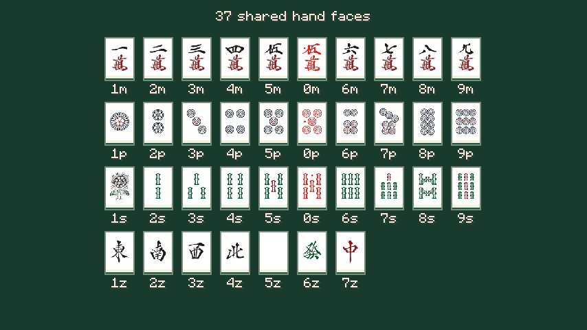
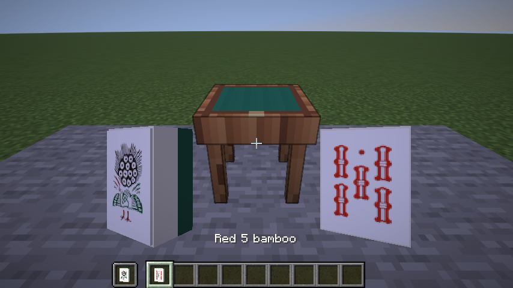

# 首套麻将牌

本页记录`0.0.9-dev`的首套模型与手牌步骤；后续`0.0.10-dev`已接入大桌公开牌面和旁观同步，见[桌面展示](TABLETOP_DISPLAY.md)。牌墙与动作动画仍待下一步设计。

用户于2026-10-17确认：采用提供的牌面、乳白牌体、深绿色素面牌背；赤五保留原图红色，白板无框纯白。本步骤完成模型、可拿取的牌物品和手牌图案；世界桌面的牌河、副露、牌墙与动画留到下一步。

## 牌面与物品

34种普通牌＋赤五万／筒／索，共37种外观。字牌按项目顺序为东南西北白发中，对应`1z..7z`；赤五为`0m/0p/0s`，普通五是`5m/5p/5s`。三麻牌池仍只有赤筒／赤索，创造栏展示赤万不改变三麻规则。

在创造模式“功能方块”分类可获取37种牌；每种都有完整的本地化名称。基础命令给一万；自定义外观可使用原版物品组件，例如：

```mcfunction
give @s riichicraft:mahjong_tile
give @s riichicraft:mahjong_tile[minecraft:item_model="riichicraft:mahjong_tiles/0s",minecraft:item_name={translate:"tile.riichicraft.red_five",with:[{translate:"tile.riichicraft.sou",with:["5"]}]}]
```

所有外观共用一个物品ID`riichicraft:mahjong_tile`，用原版`item_model`和`item_name`组件记录外观、名称，支持原版堆叠和存档。它们目前是可拿取查看的普通物品，无合成配方或落地摆牌交互；背包里的牌不参与服务器牌局，不可带入自己的牌替换手牌。

## 模型与手牌

共用原版JSON立体模型：宽2、高2.75、厚1.25个模型单位，1单位＝1/16方块；正面朝局部`+Z`，牌顶朝`+Y`。白色牌面、乳白牌体、深绿背，边缘有细小阶梯收口；GUI、双手、第三人称、掉落和展示框有独立显示变换。物品变换只用于查看，未来桌面渲染使用实际尺寸，不能把手持放大比例当作牌墙间距。

每张纹理为64×128；上方64×88区域是牌面，模型UV为`[0,0,16,11]`，手牌使用相同裁切，保持8:11比例。宽高均为2的幂，避免影响方块图集的mipmap。透明原图缩至56×77后合成到白底，保留空白边；白板直接生成纯白，不添加框线。原作者的图案和颜色保留，没有换字库重画。

手牌仍可鼠标／键盘操作，保留选中抬起与金边、摸牌间隔、不可打出灰显、完整牌名提示和旁白。选中后按原流程确认打出。紧凑牌河继续用文字表达，行动菜单与结算文字保持原流程；本步骤未重排整个界面。

## 来源与重建

用户提供的完整素材库已复制到`art/reference/mahjong_graphic/`，仅作为本地参考并被Git忽略。实际使用的36对透明PNG／SVG、许可、上游说明及SHA-256清单版本化在[art/tiles/mahjong_graphic](../art/tiles/mahjong_graphic/manifest.json)；白板为空白，无需源图。

来源：[lietxia/mahjong_graphic](https://github.com/lietxia/mahjong_graphic)，其说明引用部分字形来自[內木一郎的I.Mahjong](https://github.com/SyaoranHinata/I.Mahjong)及Gutenberg Labo的GL-MahjongTile。按上游M+许可使用、修改和再分发；[原许可](../art/tiles/mahjong_graphic/LICENSE)与[署名记录](../src/main/resources/licenses/mahjong_graphic/ATTRIBUTION.md)随JAR打包。牌体、牌背和JSON几何为项目原创。没有安装或打包字体文件，不宣称素材为本项目原创或雀魂官方美术。

```powershell
./tools/Generate-Tiles.ps1
python tools/Generate-Tile-Models.py
./tools/Check-Resources.ps1
```

生成器只依赖现有PowerShell／System.Drawing和Python标准库，不增加生产依赖；先验证输入SHA-256再从原作者PNG生成纹理，SVG作为可编辑源保留。重建不会从外部目录或网络取素材。验证证据、实际截图和当前产物以[验证记录](VALIDATION.md)为准；自动化检查和代理看图不等于人工长期手感验收。




