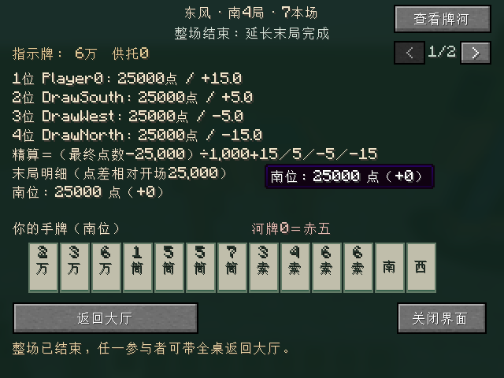

# 四人东风／半庄整场

更新：2026-10-17。当前分支 `codex/four-player-matches`，版本 `0.0.5-dev`。整场实现建立在原有四人单局上；实际验证与产物以 [VALIDATION.md](VALIDATION.md) 为准，单局操作见 [SINGLE_ROUND.md](SINGLE_ROUND.md)。

## 操作

1. 四人右键桌子自动入座，初始东位点击“赛制”按钮循环选择单局／东风／半庄。改变赛制会取消全员准备。
2. 四人准备后，由初始东位开始。当前庄家决定各人的自风，界面标题显示赛制、场风、局号和本场。
3. 每小局结算后四人各点一次“继续下一局”，齐票才开新局；缺席后全员重新确认。可关闭界面，右键重开继续查看结果。
4. 整场结果显示排名、最终点数和精算，任一参与者可“返回大厅”。中途可用“终止整场”二次确认结束。

## 已确认的交互与生命周期

用户已确认以下流程：

- 大厅保留单局，增加东风与半庄。初始东位选择赛制、开局，起家沿用自动入座的初始东位；改变赛制清空全员准备。
- 整场保持原来的四个桌位，按当前庄家计算自风；轮庄不交换玩家身份或座位。
- 小局结算后保留结果、牌河、点数和供托。四人各自确认继续，第四人确认才创建下一小局；有人缺席就清空续局确认。关闭界面不退出整场。
- 活动小局仍沿用缺席暂停、四人重新确认恢复；局间续局确认与活动局恢复确认分开处理。
- 整场中途终止仍需客户端二次确认。整场结束后，任一参与者可带全桌返回大厅，取消准备；重新开场才重置为四家各 25,000 点。
- 破桌、区块卸载、停服仍清理临时对局。本步骤没有增加保存、跨重启恢复、机器人或倒计时。

## 代码分工与进度

- `MatchRules`：独立于 Minecraft 的轮转政策和最终排名计算。排名按最终点数降序，同点按起家时的东南西北顺序；剩余供托归发放前确定的首位。25,000 返、顺位马 +15／+5／−5／−15，得分以 0.1 为单位精确计算。
- `FourPlayerMatch`：独占当前真实 `FourPlayerRound`，从已经关闭的小局账本读取点数／供托及结束事件。原小局账单保持不可变，最终剩余供托单独记在整场结果，不重写旧收据。
- 每小局使用新 UUID，继续票绑定整场 UUID、小局 UUID 和确认批次。玩家缺席时推进确认批次，使旧票失效；同批次其他人的确认不使合法票过期。
- 第四票先创建并验证完整新局，再替换旧局；失败应保留已付账结果与前三票。服务端工厂交付新局后不得继续持有并修改它，公开 UUID 与秘密洗牌种子独立生成。
- 大厅、网络、服务端与界面的赛制选择、续局、场风／本场和最终排名代码已落盘。东风只允许至南四，半庄只允许至西四的公开局号。
- `MatchRules.afterRound` 已按用户三项直接裁定实现；只读取完整结算后的结果，不在多响中途支付时判飞。规则、网络与界面不依赖对方的内部状态。

## 用户已裁定的整场边界

用户于 2026-10-17 对下列三项均明确确认。官方未完整说明的组合边界保留用户来源，不冒称新找到的官方判例：

1. **本场推进**：庄家和牌本场 +1；仅闲家和牌清零；荒牌、途中流局和流局满贯都 +1，荒牌即使轮庄也保留递增值。途中流局按连庄处理，不触发听牌止。
2. **延长骤死优先级**：每次完整小局结算后有人达到 30,000 就结束，唯多响包含庄家时优先连庄；该场末局若庄家已首位且达标，仍按自动和了止／听牌止结束。目标点不含未领供托。
3. **最大末局仍未达标**：东风最多南四，半庄最多西四；庄家和牌／荒牌听牌仍可在原局连庄，庄家不连庄时结束，绝不进入下一场。

结束检查顺序为：完整支付后有人负分；计划或最大末局庄家首位达标的和了止／听牌止；延长目标点检查（含庄家多响例外）；继续或轮庄。途中流局不根据形式听牌停止，但仍适用延长赛“每次完整结算”的目标点检查，例如含庄家多响暂时保留后，下一局途中流局仍会检查已达目标。正常场内未触及结束条件的途中流局连庄、本场 +1。

荒牌与流局满贯按庄家是否形式听牌连庄，不按流满赢家身份决定。计划末局庄家不连庄时，首位不足 30,000 才延长；最大末局不连庄则结束。同点首位使用起家顺序，负分检查发生在多响完整支付之后。最终供托发放不反过来触发延长目标。

普通雀魂基线及用户之前的单局裁定见 [FOUR_PLAYER_RULES.md](FOUR_PLAYER_RULES.md)。本次重新获取的 [官方规则](https://mahjongsoul.com/news/46) 与 [FAQ](https://mahjongsoul.com/faq) 未给出上述所有组合的完整事件例子，缺口现由用户裁定补足。

## 验证进度

- 资源静态检查已通过：8 个 JSON、6 处本地资源引用、3 个 PNG、模型边界／贴图变量、四朝向映射、中英文语言键一致。
- 排名与终算最初单独运行通过 17,575 个断言；之后加入推进矩阵，最终数量以验证记录为准。
- 跨局套件用完整物理牌墙，经真实动作入口完成轮庄、本场／供托继承、四票和缺席撤票、旧命令拒绝、错误工厂回滚，以及扣至 0 点后继续、负分击飞和余供托只发一次。独立运行 1,925 断言通过。
- 完整18套独立测试2,342,865断言、离线构建、38项服务端GameTest与最终真实TCP全通过；实际完成东风与半庄、四票续局、局间／终局重连和旧小局快照拒绝。摸打长轨迹由受控合法动作推进，赛制／续局／返回／二次终止用真实鼠标；详细证据另见验证记录。
- 四位真人长期游玩、视觉与手感没有验收。

