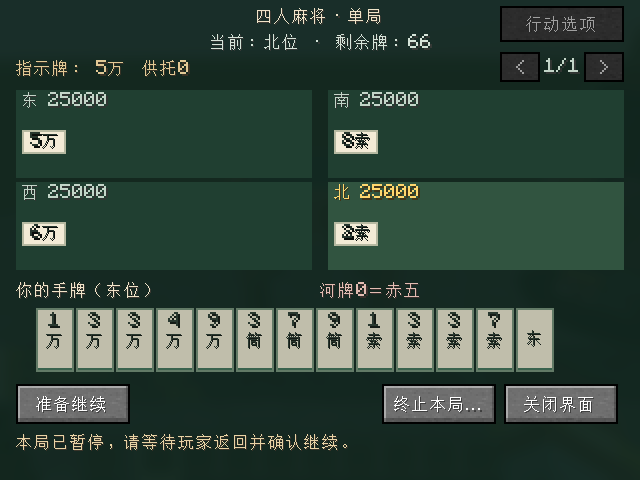
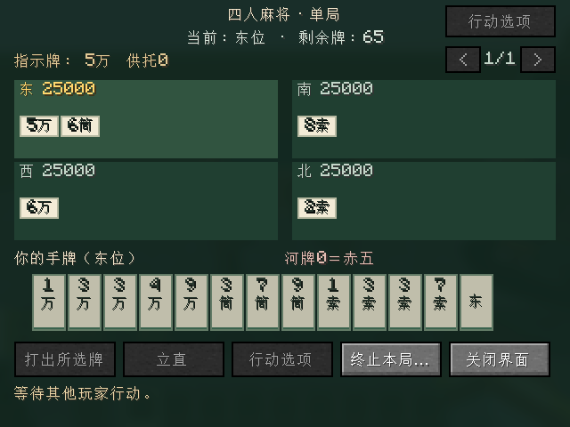

# 牌局保存与恢复

2026-10-20：`0.0.20-dev`将现有保存策略提取至独立协调器，当前版本内的保存／恢复与损坏保护继续保留，见[存档协调](PERSISTENCE_COORDINATION.md)。用户已明确开发阶段不要求兼容历史测试版，不新增迁移分支；下文版本演进与旧版读取能力仅是已有实现的历史记录，不构成长久兼容承诺。

`0.0.13-dev`扩展实体坐席：世界容器v2在每桌记录冻结椅侧顺序，原三／四麻规则重放格式不变；兼容读取v1，旧版不能读取新写出的v2容器。加载后不恢复乘坐实体，仍保留原身份及私手，回原椅并全员确认才继续。旧容器没有椅侧时沿用原入口，不静默迁移座位。实现与实际世界重开证据见[坐席与桌面操作](IMMERSIVE_TABLE.md)和[验证记录](VALIDATION.md)。

Windows测试中实际遇到短暂重命名共享拒绝。写入仍先验证并强制写入临时文件，原子替换遇到`AccessDeniedException`最多等待4次、每次25毫秒；每次重试前重新校验现存记录。永久拒绝、写入中记录损坏、线程中断或不支持原子移动仍失败并保留原记录，绝不退回非原子覆盖。有限重试只属于保存步骤，不改变每次出牌不强制落盘的边界；注入测试覆盖短暂拒绝、永久拒绝、中断、损坏与不支持原子移动。

`0.0.6-dev`完成四麻，`0.0.7-dev`扩展三麻，当前分支`codex/three-player-rules`。三麻使用独立`ThreePlayerArchiveCodec`（RC3R、schema／replay 1，三麻预设ID），三席／108牌、已拔北、补牌来源及部分抢北响应按同一引擎重放；正常恢复需三票。世界容器保留旧0～2赛制的四人布局，新增3～5赛制对应三人布局，旧四麻编码和核心契约不变，无法识别新模式的旧版本按非法元数据拒绝，不解释成四麻。下方保留四麻首版的详细验证证据，三麻最终证据见验证记录。用户于2026-10-17确认下列生命周期；本页区分已确认行为、实现设计与验证进度，最终执行结果另见 [VALIDATION.md](VALIDATION.md)。

## 已确认行为

- 正常停服或桌子区块卸载时保存；重新加载后保留原四人座位、手牌、牌山、点数、供托与已收响应。
- 活动小局恢复后先暂停，原四人回到桌旁重新确认，齐后才能继续。已在普通舍牌／抢杠窗口提交的选择保留，不把“暂停恢复确认”当作重新回答该次响应。
- 局间结果恢复后清空续局票，四人重新确认才开下一局；整场终局保留结果，不要求活动局恢复票。
- 有效牌局破桌、主动二次确认终止或终局返回大厅后清除活动存档，不能重启后复活旧局。未开局大厅不保留离线占座。
- 服务器正常自动保存写入最新已接受的状态。异常崩溃最多回到最近一次成功保存；本版不在每次摸打后强制磁盘同步。
- 校验失败保留原记录、提示错误，禁止自动创建新局覆盖。损坏记录不因拆桌被自动丢弃，需要管理员修复；本版不提供一键清损坏档的操作。

这替代旧版本“卸载／停服直接终止”的临时行为，不改变日麻规则，不增加倒计时、跨世界点数账户或机器人。

## 实现设计

规则核心使用服务器专有的保存接口，与客户端公开视图分离。每个当前小局保存开局前账本、完整136牌初始牌墙及按实际先后接受的动作；恢复用同一引擎逐条重放，自动摸牌、自动PASS、立直扣棒和结算由原流程产生，不另外重复执行。部分响应、食替、一发、振听、延后杠宝、抢杠牌归属和包牌历史因此保留。

整场另保存当前局号、起家、修订、确认批次、过去使用的小局ID等元数据，仅重放当前小局；恢复不先创建新25,000点牌局、不调用随机发牌工厂。下一局和终场摘要按完整旧账本重算校验，剩余供托不再计入旧小局账本。

核心和世界容器都有版本与SHA-256完整性校验。长度、牌ID、人数、动作数等在分配前检查，拒绝截断、尾字节、未知版本、不合法动作及不能重放为ACCEPTED的历史。当前核心schema／replay均为1，绑定`FourPlayerRules.ID`与revision；规则版本不兼容时阻止恢复，不擅自以新规则解释旧牌局。完整性校验用于发现损坏，不阻止有服务器文件修改权的人主动重写存档。

单局日志上限1,024条（合法完整136牌小局远少于此），核心2MiB、世界容器64MiB／4,096桌，先检查长度再分配。每个历史局只保留UUID与整场元数据，动作日志仅保存当前小局，不重放整场历史。

世界存储为`<世界>/data/riichicraft/tables.dat`，只由服务端读写，包含未加载区块的活动桌与UUID占座索引，避免原玩家在另一桌重复占座。客户端不接收初始牌墙、动作日志或他家暗手。区块卸载时内存挂起并保存，不保持区块票；加载回调只读传入区块，服务端tick通过现成FULL区块刷新，不等待或强制加载。

每次写盘先检查既有文件，再将新数据写入同目录临时文件、同步并回读校验，最后原子替换；原子替换不可用则保留旧文件并报错。全文件损坏时禁止写入；单个核心记录损坏时保留该记录及占座，其余有效桌可正常保存。不使用读取失败后自动创建空值并覆盖原文件的路径。停服首次保存即使失败，脱离运行态后也禁止再次将清空的内存写回，保留最近成功记录。

## 已执行验证

- 独立脚本20套测试2,346,331断言通过；世界容器527项、核心归档2,939项。两个全新Java进程实际保存／恢复部分荣和、待成立立直、已完成双响及多种同分解释的自摸、最终供托，读档后字节稳定且可继续同一合法后缀。最终Gradle构建因多3个项目内类路径检查，共2,346,334项，归档套件2,942项；没有少跑或排除旧测试。
- 最终完整离线构建55秒成功，42项required服务端GameTest／11.19秒全通过。实际注入停服写入失败，确认后续保存不能把已清空运行态覆盖旧记录；独立服务重建验证部分响应、局间清票、已付结果、无效核心占座及全文件损坏保护。卸载由Fabric事件invoker触发，不冒称已执行引擎自然卸载的完整循环。
- 最终真实TCP客户端回归1分44秒成功，保留完整单局、东风与半庄场景。存档部分在同一JVM内正常停止原生专用服务器，再由另一个原生专用服务器实例重开同一磁盘世界；一个真实TCP客户端加三名同UUID原生服务端夹具重新连接，四家暗手、原响应序号／已收选择与活牌数一致。旧视图不能操作；三票不能恢复，真实客户端鼠标投第四票后只处理原窗口剩余响应，二次终止清除活动档。
- 首轮真实TCP重启曾暴露区块加载回调等待自身FULL future的死锁。修复为只读传入区块，并在tick／交互使用`getChunkNow`，上述最终构建及TCP均在修复后重跑通过；未放宽看门狗或测试超时。
- 已查看保存前、恢复暂停及恢复继续的320×240 GUI截图。没有执行四位真人长期视觉／手感验收、正式启动器安装、整台机器重启或强杀崩溃测试；全新JVM证据限独立核心归档，不能替代服务端进程级硬崩溃验证。

所有开发测试文件和世界位于本仓库忽略目录；没有读取启动器、外部玩家存档、全局缓存或外部记忆。
