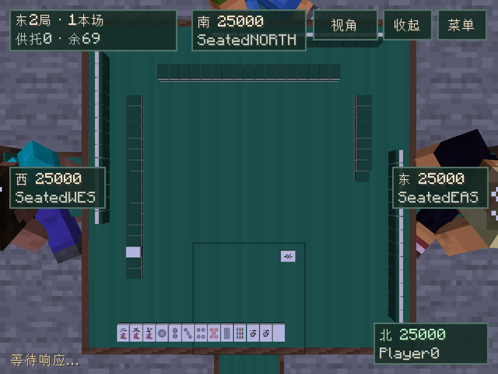

# 10月18日试玩问题修复

日期：2026-10-19，开发版`0.0.16-dev`。用户五项试玩反馈已实现；最终完整构建、88项原生服务端检查及真实TCP客户端回归通过。真人多人长期操作体验仍待试玩。

## 修复范围

1. **摸牌闪现**：私人手牌与公开牌桌走不同消息，原先会把已知的新摸牌直接补到尚未出现的动画终点。现在只在对应公开局面的动画槽到达后显示新摸牌；公开局面标签还区分张数不变的杠／拔北补牌和排队中的旧动画。动画不修改服务器牌序，也不额外发送隐藏牌。
2. **结算崩溃**：报告为`ArrayIndexOutOfBoundsException: Index -8 out of bounds for length 9`，位于`TableScreen.drawResult:428`。结算／说明／牌河的页码现在在按钮回调、控件重建和绘制入口都限制在有效范围。负页码路径明确，究竟哪次实际输入将页码减到负数仍不能只凭报告断言；按报告的1920×1080、界面缩放4（480×270）补充边界回归。
3. **Esc镜头**：退出桌面操作层时返回坐姿／普通视角，继续保留座位和牌局身份；R／收起按钮采用相同关闭行为。重新打开操作层不自动抢回俯瞰，新局和新结算仍按已有方案自动取景；菜单中的第一次Esc仍只关闭菜单。
4. **里宝指示**：仅和牌赢家中有人已成立立直时公开有效里宝指示牌，即使里宝计数为0也展示。四麻和三麻、单局及整场共用服务器实际牌山中的有效指示牌；流局、非立直和牌与活动局均不公开。王牌下层对应牌向桌缘展开，原位置不再保留重复牌体；结算卡及旧界面同时列出牌名。不改变番符或支付。
5. **响应提示**：真实响应不标出哪家正在思考；本人仍立即收到合法吃碰杠／和牌选项。无人有真实响应且将进入下一摸时，独立抽取25%概率的假等待；4～40个服务器tick（约0.2～2秒），各时长权重`1/t`，短等待更常见。全桌一致显示等待，期间下一张牌、行动选项和实际摸牌动画尚不对外显示，也不能提前提交下一手。和牌／流局直接展示结果，不追加假等待。

等待属于服务器控制的显示时序，独立规则核心已经接受并记录的动作保持完整；期间保存也保留最新核心与牌山。暂停／缺席清掉临时等待，重新加载先按原规则暂停，恢复后不重播假等待。没有新增响应超时或自动代打；真实响应多久结束仍取决于参与者的选择。

## 网络与兼容

新增终局里宝及公开局面匹配字段，使用`lobby_snapshot_v2`、`table_display_v4`和`table_scene_v2`载荷。客户端和服务器必须一并更新到本版。规则核心、重放档案和世界存档格式不变；可读现有牌局。无新生产依赖，个性化／道场／世界生成未开展。

## 验证与交付

测试中的随机等待通过独立测试模组注入确定时长：旧规则与快速交互回归使用0，新计时检查强制4／40tick，另对25%选择及递减分布做确定性覆盖。这个测试模组和夹具不进入生产JAR；不能将强制等待测试冒称随机抽样的真人体验。

最终`build sourcesJar`1分11秒成功，原27套／5,661,287断言保留，88项原生服务端检查／16.76秒通过。新增检查涵盖三／四麻六个模式的等待、输入拒绝、手牌／牌山守恒、等待中保存再加载，以及完整物理牌墙和真实合法立直／自摸形成的零里宝和牌。真实TCP客户端回归2分27秒成功：消息先后与同张数旧动画的几何检查、实际Esc、原报错尺寸的结算／菜单分页、实际等待与可见提示、正常世界新服务器实例重开均通过。范围与中途失败记录见[验证记录](VALIDATION.md)。

本地修复包：`build/dist/riichicraft-0.0.16-dev-playtest.zip`（812,275字节），包含生产JAR、中文说明和校验值，解包JAR已核对一致，不包含用户日志或测试模组。仅将JAR替换到各客户端及服务器的`mods`目录，并保留适配26.2的Fabric API；旧Riichicraft JAR需移走，避免同时安装两版。

JAR：`build/libs/riichicraft-0.0.16-dev.jar`（890,435字节）；SHA-256：

```text
2dc248499ec8e60851dc4d73b0e91c63e9db8657f6f3ceef596b1f0e1e03d7a5
```

199个规则class与0.0.15字节一致，37牌和原许可保留；新增测试模组与夹具不在生产包中。用户正常联机关注闪牌、结算和视角即可；内部边界由代理完成，自动检查不能代替朋友多人长期体验。



[原报错480×270缩放下的结算卡](images/playtest-result-scale-four.png)为实际合法牌局结果；[五组表／里指示的布局图](images/playtest-ura-layout.png)为明确的客户端布局夹具，验证展开位置，不冒称该局实际开过四杠。真正零里宝立直和牌由服务端完整牌墙／合法动作测试覆盖。
