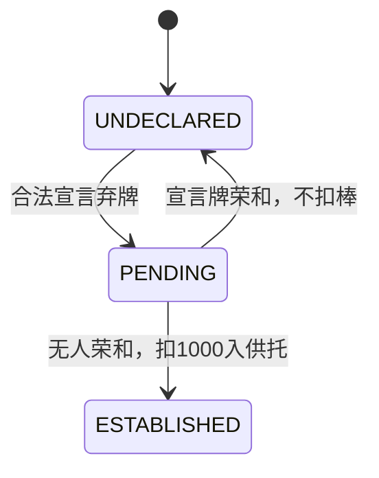

# 独立立直、弃牌与小局账本

开发版本：`0.0.5-dev`。本页保留弃牌、立直与账本组件契约；已由 [统一单局引擎](SINGLE_ROUND_CORE.md)接入完整阶段、舍牌／抢杠窗口、真实和牌机会、流局和责任历史，并接入Minecraft，见 [SINGLE_ROUND.md](SINGLE_ROUND.md)。整场轮转现已实现，见 [MATCHES.md](MATCHES.md)；最终运行覆盖以 [VALIDATION.md](VALIDATION.md)为准。

## 来源与已确认时点

2026-10-16 用户确认：四麻立直宣言后活牌山至少剩四枚；宣言牌先接受荣和响应，被荣和不成立立直、不扣新棒，无人荣和才扣 1,000 入供托，即使该牌被吃碰也成立。本人第一次出牌且此前无人吃碰杠可双立直。一发保持到本人下次摸牌后的弃牌，期间已成立的吃碰杠取消一发。

上述精确时点来源为用户确认。[雀魂官方段位规则](https://mahjongsoul.com/news/46)另明确至少 1,000 点且有摸番、允许振听／空听立直；[官方 FAQ](https://mahjongsoul.com/faq) id47 定义双立直和一发。后续用户又单独确认被抢的未成立杠保留原有有效一发，已落实在 [KAN_FLOW.md](KAN_FLOW.md)；不冒称另有官方完整时序原文。

多人和本场／供托独取最近赢家、责任支付的范围及拆分方式来自上述官方段位规则。下文具体账单是按这些已核实公式推导并测试，非官方原文逐例账单；责任触发的精确历史边界现按后续用户直接确认实现，见下文。

## 弃牌与立直状态

`DiscardActions.afterDrawOptions()` 接收十四张结构手牌和确切摸牌 ID。未立直时可打任一暗手牌；已立直／双立直时只可打那枚实际摸牌，不能用另一枚同种普通／赤牌替换。声明组不在可弃牌集合中。

`afterDraw()` 输出十三张结构手牌、舍牌、是否摸切及更新的振听历史。它不会自行清同巡振听；拥有者须在此前真实摸牌事件调用 `history.afterDraw()`。`afterCall()` 仅消费已执行的吃／碰结果，使用其食替遮罩直接弃牌，不普通摸牌、不清同巡振听；大明杠必须先摸岭上，再进入 `afterDraw()`。

`RiichiState` 的内部状态只能通过以下流程产生：

`declarationOptions()` 为每个确切物理弃牌返回弃牌后的结构等待。条件为尚未宣言、门清、持点至少 1,000、活牌至少四枚，且弃牌后存在真实结构等待；不按役、振听、外部牌已见尽或牌山库存过滤，立直本身提供役。七对子和国士可参与；暗杠保持门清，但任何已声明组都证明此前有吃碰杠，不能同时声称全场从未鸣牌。自持四枚而只求第五枚单骑不提供。荒牌形式听牌现另由 `RoundDrawRules.tenpai()` 裁决，不把此候选映射直接当作流局结果。

`declare()` 验证并执行确切弃牌，绑定接下来唯一的 `DiscardResponseWindow.Id`、出牌座位和物理宣言牌，状态变为 `PENDING`。此时 `establishedRiichi()` 仍为 `NONE`，不授予立直役／永久见逃标志，也不收棒。原振听历史不被清除。

`resolve(window)` 要求完全匹配的局／窗口号、出牌者和物理牌，且三家已收齐。任何一家荣和，包括双响／三响，取消宣言并输出零扣点／零新供托；否则成立并输出 -1,000 点和一根供托。宣言牌被吃碰仍保留立直／双立直，但一发立即取消。`RoundLedger.establishRiichi()` 负责在真实账本中原子记账。

`afterOwnDraw()` 保留一发，允许下一次摸牌一发自摸；`afterOwnDiscard()` 使其过期；`afterCallEstablished()` 在真正成立的任一家吃碰杠后取消。两者均不取消立直或重新激活一发。宣言弃牌已在成立前执行，不能在成立后又将同一弃牌当作“下一次本人弃牌”处理。待响应时禁止推进这些后续事件。

## 小局账本与支付

`RoundLedger.initial(roundId, dealerSeat)` 为四家各 25,000、零本场／供托。后续小局可用 `begin()` 携带上局点数、本场和未领取供托；拥有者必须使用新的小局 ID。构造及每次更新均要求四家点数＋供托池恰为 100,000，点数为百点单位。

`establishRiichi(pending, window)` 内部重新核对真实响应结果，并检查账本当前确有 1,000 点，不只信任宣言时旧的余额快照。成功把该玩家 1,000 转到供托；宣言牌被荣和则不动钱。两种结果都记录窗口收据，同一当前账本不能再次处理该宣言。恰好 1,000 立直后可以为零。

`settleRon()` 只消费本小局已完整裁决的实际舍牌或抢杠荣和窗口，采用全部赢家及其计分结果；`settleTsumo()` 消费拥有者已经建立真实自摸机会的允许结果。二者重新核对实际庄家与荣和／自摸支付方式，不能用振听被拒的手牌付款或把荣和价值当作自摸支付。自摸输入自身仍不是完整局号／阶段／网络授权，真正机会现由 `FourPlayerRound` 建立。

- 普通荣和由放铳家支付各赢家手牌价值；自摸逐家使用已向上到百点的基础支付。
- 每本场荣和 300、自摸三家各 100。双响／三响只给出牌者之后按摸打顺序最近赢家本场与全部供托；其余赢家仍收各自完整手牌价值。
- `Pao(liableSeat, component)` 仅接受大三元／大四喜，且该组件必须在赢家真役满中存在；不能包自己。包牌只覆盖该组件，大四喜的双倍按两单位覆盖，其余复合役满照常分摊。
- 包牌自摸由包家全付该组件；荣和时包家和放铳家各半；两者相同则同一家承担全额。最近赢家有包牌时本场由该包家承担；较远包牌赢家不另收本场。供托始终只归最近赢家。
- 结果含逐项付款、赢家顺序和新账本。允许结算后点数为负，绝不截断应付金额；击飞及整场结束由`FourPlayerMatch`在完整支付后处理。整数溢出拒绝且不更新任何原对象。
- 和牌或流局结算令该小局账本关闭，不能再次荣和、自摸、流局或处理新立直；这防止在已更新的当前账本上重复支付。不可变旧快照不是网络防重放存储，统一单局保存并替换唯一当前状态；跨小局与重启身份管理仍归外层。

包牌账本输入必须是可信历史，不能根据最终役名反推或接受客户端自报。现由 `RoundDrawRules.responsibility()` 与统一单局在实际鸣牌成立时建立：此前两种三元／三种风的声明刻杠（含声明暗杠）后，最后一种由他家供碰／大明杠则记录提供者；未声明暗刻不算，最后自行暗杠不新增，加杠沿用原碰历史。此精确边界是 2026-10-16 用户确认，非新增官方逐例原文。

`settleExhaustive(tenpai,nagashi)` 已实现荒牌与流满支付；拥有者必须先建立真实荒牌机会和资格，客户端不能自报集合。一般荒牌仅混合听／不听时总计转移 3,000；两听两不听各收／付 1,500，收据以实际百点义务分配，不制造 750 点付款。存在流满时替代不听罚符，按每名流满者独立满贯自摸互付，不加本场或领取供托。`settleAbortive()` 不移点；这两种流局结算均保留全部供托。

流满要求门清（暗杠允许）、非空全幺九牌河且无本人舍牌被鸣走，是用户明确裁定。单局输出是否连庄：和牌看赢家是否含庄家，荒牌／流满看庄家是否听牌，途中流局为真；新局、本场和整场停止由`MatchRules`／`FourPlayerMatch`处理，不修改已经关闭的单局收据。

## 可核对的账单

设东座 0 为庄、座 1 子家有大三元＋字一色两单位役满，座 2 是大三元包家，座 3 放铳；两本场、原供托三根。独立普通支付为 64,000，其中仅大三元 32,000 有责任：

| 事件 | 座 0 支付 | 座 2 支付 | 座 3 支付 | 座 1 收到（含供托） |
| --- | --- | --- | --- | --- |
| 荣和座 3 | 0 | 16,000＋600 本场 | 32,000 字一色＋16,000 大三元 | 67,600 |
| 自摸 | 16,000 字一色 | 8,000 字一色＋32,000 大三元＋600 本场 | 8,000 字一色 | 67,600 |

同包家兼放铳家时，该家承担两个半额之和；双倍大四喜整体是两单位责任组件，不按单倍减付。双响／三响中上述本场／供托只在该赢家最近时领取，独立测试另覆盖最近赢家没有包牌、较远赢家有包牌，及包家自己也是另一位赢家的净账。

## 验证

新出牌套件 9,202 个断言：160 种子逐枚弃牌守恒、赤／普通实体摸切锁、吃碰食替与同巡保持、大明杠须先岭上。立直 325 个断言：点数／四枚活牌临界、特殊形、暗杠门清、振听、宣言绑定、四种座位及七个荣和子集、吃碰宣言牌、双立直和一发时序。

账本 3,201 个断言：全部庄家／放铳家／一二三响组合，真实一番 30 符自摸，组件包牌与双倍大四喜的所有赢家／庄家／包家位置，包家与放铳家合一、多响本场交叠、零／负点、溢出与重复／过期小局／错误支付方式。与其余套件由统一独立入口运行；构建与服务端回归见 [VALIDATION.md](VALIDATION.md)。

后续 `RoundDrawTests` 新增 103,218 个断言，覆盖全部听牌／流满集合、四庄位和负分／供托账本、回执重建、重复结算以及真实资格与包牌边界；统一单局的确定墙场景还实际执行立直成立／取消、四立直及荣和优先、真实大三元包牌与流满，见 [SINGLE_ROUND_CORE.md](SINGLE_ROUND_CORE.md)。这些证据不代替游戏网络与界面验证。
