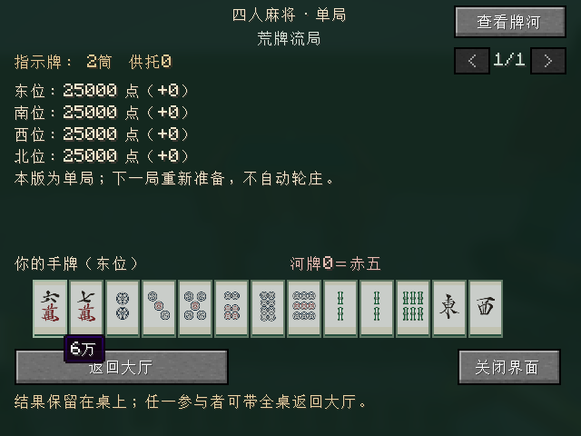
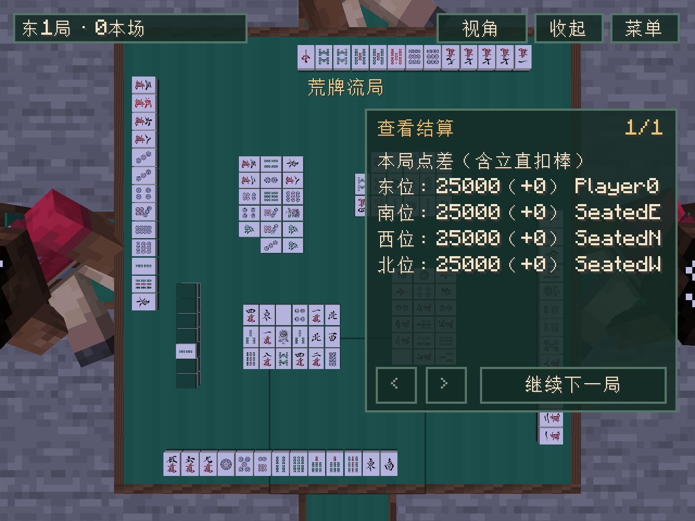

# 新旧界面共用展示转换

日期：2026-10-20，开发版`0.0.18-dev`。从已验证的`0.0.17-dev`／`2695b99`继续，落实[全面审计](CODE_AUDIT.md)提出的界面职责整理。

## 实现范围

新增客户端`GamePresentation`，集中将接收者快照转换为结算摘要、结算文字、座风和动作标签。`GamePanel`与`TableScreen`保留自己的布局、分页、选牌、动作分组、发送请求和镜头处理，只委托共用展示转换。

结算摘要使用不可变座位列表，同时保留：

- 核心记录的本局结算点数；整场最终排名中的展示点数。
- 本小局变化：已成立立直扣款＋实际支付流水＋整场最后供托分配。
- 旧界面累计变化：相对于25,000／35,000开场点数的差值。

大桌结果卡继续显示本小局变化，旧界面继续显示累计变化；两种数值和各自原有行顺序均保留。整场最后分配的供托只显示一次，最终排名覆盖展示点数，已分配的供托不再显示为桌面池。番符、役满、宝牌／拔北、里宝、支付和排名文字的公共构造集中维护。

本轮统一动作标签映射，保留两界面的原有选项排序、去重与合法名单处理。没有增加客户端自行判断合法动作的逻辑，也没有改变按钮、交互、麻将规则、服务端状态、网络载荷或存档格式；没有新增依赖。

## 重构前后对照

先在实际Minecraft客户端运行原v17界面，保存其48组结算和11组动作输出。采集器同时校验原生产JAR的SHA，以及运行中`GamePanel.class`／`TableScreen.class`与原JAR对应字节一致，拒绝覆盖已有输出。

基准写入器：`0.0.17-dev`，源码检查点`63ba8dfdbb5fb43584113142a182fb386758a6dc`，JAR SHA-256：

```text
f849d904421bfab3d7e626af6429fc965fc917dbba3467fea53c45538004ba4c
```

固定资源：[presentation-v17.json](../src/gametest/resources/dev/riichicraft/client/presentation-v17.json)，253,908字节，SHA-256`6157d52fd3cde55fab159ba01be7b1995a526c12d12b27519add976ad3b0ac1d`。它保存原Component树的翻译键、嵌套参数、数值、文本和行顺序，不受当前界面语言影响。正常回归只读取样本，不调用`capture()`写入入口或重生成预期结果。

夹具包含三／四麻、两种庄位、八类终局、多人荣和、复合役满、三麻拔北、里宝指示、已成立与待成立立直、局间和整场最后供托、排名顺序与座位顺序不一致，以及有符号小数的整数边界。它们是明确的显示输入，不冒称每组都来自完整合法牌局；真实牌局由已有核心与TCP场景另外覆盖。

[GamePresentationChecks](../src/gametest/java/dev/riichicraft/client/GamePresentationChecks.java)逐行比较新转换和两套实际界面入口的输出；另按手算支付核对两种点差、最后供托和最终点数，检查不可变摘要及界面间Component修改隔离。动作样本保留赤／普通五的区别。

原采集第一轮因夹具里宝数量与表宝数量不符而失败，修正输入后受字节校验保护的专用采集运行35秒成功；该次只采集样本，不当作完整TCP回归。日志为项目`.tmp/presentation-refactor/baseline-client.log`和`capture-client.log`。

## 验证与交付

最终`build sourcesJar runClientGameTest`合计**4分8秒成功**，日志`.tmp/presentation-refactor/validation.log`：

- 原29套／5,664,445规则断言及14份旧档兼容检查保留；94 required服务端测试／23.36秒全部通过。
- 新共享展示1,933断言通过；原25,914动画帧断言、真实TCP三四麻、按键／鼠标／分页、生存合成、观战和正常保存后另一专用服务器实例重开世界均通过。
- 静态115 JSON／105引用／45资源PNG、44家具映射及双语通过。正式包逐一排除77个测试源类型及内部类，基准／采集器不进入正式JAR或源码包。
- 全部293个非客户端生产class与v17逐字节相同，包含199个规则class。已有生产class仅两界面及两个内部类字节变化；内部类经`javap -p -c`对照确认可执行代码相同，变化来自源码调试位置。新增3个class为`GamePresentation`及两个摘要record。源码包314条目。

本轮两套实际结果界面截图已保存并查看：





图像来自真实TCP客户端，其余座位为服务端原生测试玩家；不把图像当作真人多人长期手感验收。

生产JAR`build/libs/riichicraft-0.0.18-dev.jar`：903,348字节／530条目，SHA-256`a9572d5ea1240f0abe31f8aa9fcaf771cb7145fdabc2b692ef703dfa064c2cce`。试玩包`build/dist/riichicraft-0.0.18-dev-playtest.zip`：824,049字节，仅含同一JAR、中文说明与SHA，解包核对一致；ZIP SHA-256`c4a3ab155664c4d486cced96e29ab5c2bdb095fac7a55670bacd0540da47b8c8`。保留37种牌面与原素材许可，客户端／服务器一并替换同版Riichicraft，继续使用对应Fabric API。

取样与冻结资源提交`b3136ec`，客户端职责提取与回归提交`5e80114`；完整检查点、固定`v0.0.18-dev`标签及远程核对见[接续记录](SESSION_STATUS.md)。最终验证后Gradle已停止，未移动旧标签或创建GitHub Release。

本轮之后再按小步骤整理服务端纯快照转换，继续保持固定旧档与正常世界重开验证。人工多人长期手感仍从正常游戏反馈补充。
