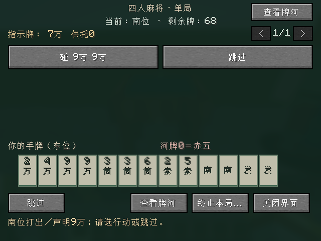
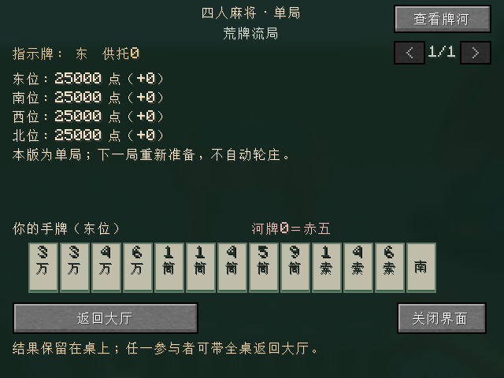

# 四人单局：游戏操作与实现边界

开发版本：`0.0.4-dev`，目标 **Minecraft Java 26.2 / Fabric**。当前已将独立四麻规则核心接入实体麻将桌和操作界面，支持摸打、吃碰杠、立直、自摸／荣和、流局与点数结算。客户端与专用服务器需安装相同开发版本及兼容的 Fabric API。

这是每次独立开始的一小局：四家各 25,000 点，东场、东位为庄，零本场和零供托起步；本局内立直扣棒、和牌／流局都按规则结算。结束后暂不自动连庄或轮庄；返回大厅、重新准备并开始时，四家重新各 25,000 点。东风／半庄整场和三麻尚未实现。

## 开局与操作

1. 放置麻将桌并普通右键打开大厅，点击“自动入座”；座位按东、南、西、北自动分配。
2. 四人全部准备后，由东位点击“开始本局”。本版没有机器人补位。
3. 本人回合先选一枚手牌，再点“打出所选牌”。摸牌单独显示；是否能打出取决于服务端发送的合法牌集合。
4. 有合法响应时打开行动页，选择其中一个确切的组合、荣和或“跳过”；本人可自摸或开杠时，从“自摸／其他”或“行动选项”进入。
5. 和牌或流局后查看结算，任一参与者可点“返回大厅”带全桌返回并取消全员准备。

创造模式可在功能方块中找到麻将桌，或执行 `/give @s riichicraft:mahjong_table`。暂不提供生存配方、坐姿动画和实体堆牌／掷骰开门动画。

| 情况 | 操作与裁决 |
| --- | --- |
| 普通弃牌 | 选择服务端允许打出的确切牌，再确认打出；当前不是本人回合时不能出牌 |
| 立直 | 先选要打出的宣言牌，符合条件时“立直”按钮可用；宣言牌先受理荣和，无人荣和才扣 1,000 入供托 |
| 吃／碰／大明杠 | 行动按钮列出将使用的持牌；保留赤／非赤组合差异。牌面完全相同的普通副本组合在界面合并为一个具体选择，服务端仍接收准确物理 ID |
| 吃碰后弃牌 | 不再普通摸牌；同种现物及规定的另一顺子完成牌受食替限制，不可选中打出。例：23 吃 1 后禁 1／4；赤五与普通五按同种限制 |
| 暗杠／加杠 | 从行动页选择合法组合；先等待抢杠响应，未被抢才正式开杠并摸岭上。加杠保留原碰来源 |
| 荣和／抢杠／跳过 | 选择本次窗口提供的动作；收齐三家后按荣和＞碰／大明杠＞吃处理，允许双响和一炮三响，没有可选动作时自动跳过 |
| 自摸／九种九牌 | 只有真实满足条件时提供；九种九牌为未受成立吃碰杠打断的本人首摸选择 |

行动没有倒计时；拥有合法响应的玩家需要选择动作或跳过。其他家先响应不会使本家的同一窗口失效。关闭界面不会替玩家跳过或自动弃牌，可以再次右键桌子打开。

## 牌河、行动与结算页面

牌河页显示四家点数、暗手数量、声明组、立直／宣言状态及公开舍牌。宣言牌和被鸣走的牌保留标记，悬停可查看；被鸣走的舍牌仍参与原主的振听历史。

行动页按按钮列出具体动作，保留赤牌选择，超过一页可翻页；响应窗口到来时有动作的玩家自动进入该页。牌河与结算也支持翻页，长牌河、多个赢家及付款明细不会仅靠一屏裁剪。页面右上方可切换“查看牌河”与行动／结算。

结算页保留结束原因、赢家、四家点数及相对本局 25,000 的变化、形式听牌者、役名／番符或役满倍数、宝牌数量和逐项付款。当前只显示赢家的役与得点摘要，**没有完整和牌手牌展示**；这不影响服务端按完整牌形计分。

## 已接入的规则

采用 [四麻规则基线](FOUR_PLAYER_RULES.md) 中的雀魂普通四麻规则与明确标注的用户裁定：标准形、七对子、国士、普通役／役满、番符与宝牌，舍牌／同巡／立直振听、食替、立直／双立直／一发、抢杠、岭上及翻宝，多响、本场／供托和大三元／大四喜组件包牌。无役的结构完成牌也参与见逃振听，来源是用户直接确认。

荒牌、九种九牌、四风连打、四家立直和多人四杠流局均已接入；四风、第四立直及第四杠的指定舍牌先受理荣和。荒牌形式听牌不受无役、振听或外部待牌见尽影响，自持四枚只能求第五枚不算听。

流局满贯在本项目采用用户明确裁定：本人须门清（合法暗杠允许），牌河非空、全为幺九、无本人舍牌被他家鸣走；多人各自按满贯自摸收款且彼此支付，不加本场费、不领取供托。这里只在本局账本中保留未领取供托；当前单局模式的新局仍从零供托与 25,000 点重新开始。

## 暂停、终局与临时数据

活动局中，参与者掉线、死亡、转为旁观模式、跨维度或离桌过远会暂停，保留当时手牌、牌山、响应与点数。四人全部回桌后逐一确认继续，第四人确认后恢复；任何人再次缺席会清空已有继续确认。关闭界面只隐藏窗口，不离座、不暂停。

活动局仍可经界面二次确认主动终止，返回大厅并取消准备。已完成的和牌／流局则保留结果和牌河：关闭后可重开，终局掉线不会撤销已经结算的点数，也不会把终局重新变成活动局；任一参与者点击“返回大厅”后结束这份结果的保留。

破坏桌子、卸载区块或停服仍清理临时单局。本版没有跨重启牌局恢复或长期点数账户；新局不继承上局积分、供托与庄位。

## 服务端与验证边界

服务端使用 `FourPlayerRound` 保存唯一当前牌局；连接 UUID、桌视图 ID、小局 ID、阶段、修订及稳定响应窗口共同限制请求。客户端只提交意图和选中的准确牌，不能自报和牌得点、包家或别家座位。动作牌数量、响应组合、牌河、役与付款列表均有编码长度上限，解码及构造时验证，非法请求不推进对局。

`GameSnapshot` 按接收者生成：只发送本人暗手、本人动作与四家公开信息，不发送他人私手、洗牌种子、牌山顺序、未翻表宝或隐藏里指示牌。结算可显示里宝计数，但不广播隐藏牌山。独立 `serverState()` 仅供服务端诊断，不作为网络快照。

离线核心十六套共 **1,576,377 个断言**，覆盖完整物理墙、实际和牌／立直／鸣牌与流局、身份和私手隔离、136 枚牌及点数守恒，详见 [独立单局核心](SINGLE_ROUND_CORE.md)。最终构建、35 项 required 服务端 GameTest 和真实 TCP 客户端均通过，包含真实鼠标碰牌／立即弃牌与终局重连；截图、产物及哪些复杂按钮尚未逐个实机操作，见 [VALIDATION.md](VALIDATION.md)。

真实 TCP 自动验证使用 **一个真实客户端＋三名原生 `ServerPlayer`／内存通道夹具**，验证该客户端与专用服务器的连接和操作；不是四真人或四个真实客户端的联机验收。人工视觉、长期操作手感和正式启动器安装仍需另行验收，不能从编译或自动截图推定完成。
