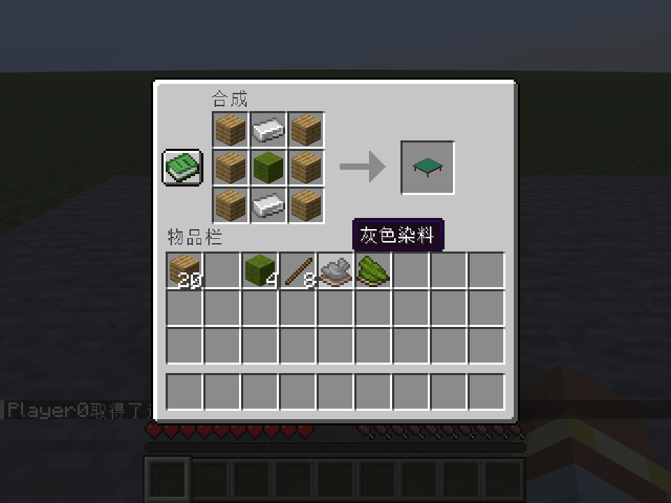
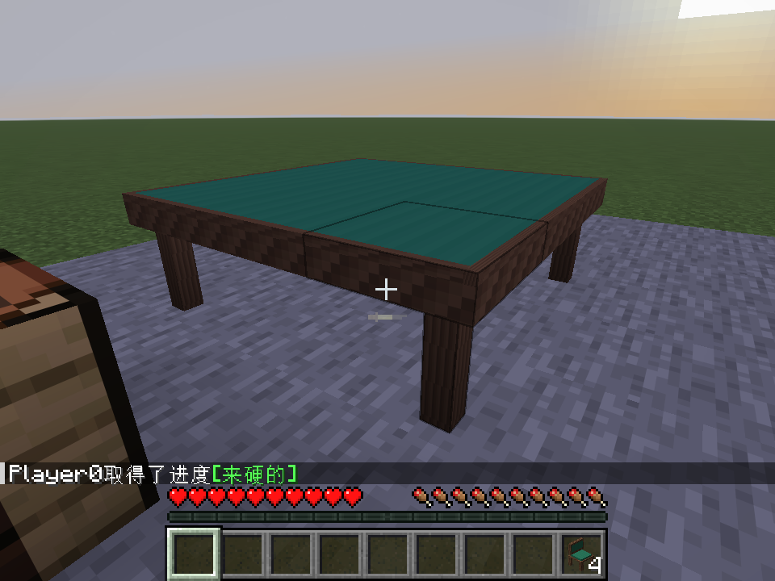

# 生存获取与朋友试玩

2026-10-19：当前推荐使用`0.0.16-dev`试玩修复版，配方不变，最新安装包与验证见[本轮修复](PLAYTEST_FIXES.md)。下文0.0.15产物校验值保留为历史记录。
日期：2026-10-18。用户已确认首版配方和优先级，`0.0.15-dev`已完成构建、85项原生服务端测试及实际TCP客户端自动回归。现在可在生存世界获得一套可开局的大桌与椅子，交付后等待朋友实机反馈；三／四真人长期体验尚未验收。

## 配方

每次合成均产出一件。`P`可为任意原版木板，也可混用不同木板；`W`为原版绿色羊毛`minecraft:green_wool`，不是黄绿色。染料采用原版绿色／灰色，不新增深绿色材料。

大麻将桌：`I`为铁锭，消耗6木板、2铁锭、1绿色羊毛。

```text
P I P
P W P
P I P
```

麻将椅：`S`为木棍，空格留空；消耗5木板、2木棍、1绿色羊毛。

```text
P P P
P W P
S   S
```

- 普通麻将椅＋灰色染料 → 空椅子，无序合成。
- 空椅子＋绿色染料 → 普通麻将椅，无序合成。

两种转换可在背包2×2或工作台3×3中进行，只处理背包中的物品，不直接改变已放置的椅子或活动牌局。每次消耗原椅与一份染料，不返还旧染料，也不多产椅子。

获得木板后解锁桌、椅配方；获得普通椅解锁空椅转换，获得空椅解锁还原配方。标准工作台与原版配方书完成合成，没有独立机器界面。

一桌四把普通椅共需26木板、2铁锭、5绿色羊毛、8木棍；三麻另用一份灰色染料把其中一椅转为空椅。放置桌子仍一次使用一件物品形成3×3桌体，拆任一桌体部分只回收一件桌子。四把椅子均须朝桌心，详见[摆放说明](TABLE_AND_CHAIRS.md)。

当前物品牌只作展示，牌局由桌子自动配牌，不需要收集136张／108张背包牌。37种装饰牌的制作、旧单方块原型桌的生存配方、自动桌、矿物／机器与道场个性化不在本步内。

## 今晚试玩

客户端与服务器都更新到相同开发版，并使用Minecraft Java26.2／Fabric和兼容Fabric API。先由代理完成资源、构建、实际服务端／客户端自动检查；多人手感由朋友正常打一场来反馈，不要求人工重跑内部测试。

1. 合成并摆好一张大桌、四把朝心的椅子；三麻把一把换为空椅子。右键所选椅子坐下，全部准备后起家开局。
2. 正常打一场，重点感受读牌、双击弃牌、吃碰杠选择、镜头切换和小结算卡。默认V切视角、R收起／重开，收起后Shift起身；起身会暂停保留牌局。
3. 有问题记下当时操作、预期和实际表现；附截图或相应客户端／服务端日志即可。不要求每个人重复所有边界。

本地试玩包：`build/dist/riichicraft-0.0.15-dev-playtest.zip`，内含正式模组JAR、中文试玩说明和校验值，不附带Minecraft、Fabric API或测试夹具。解压后仅把`riichicraft-0.0.15-dev.jar`放入各客户端／服务器的`mods`目录，替换旧版；不要直接把ZIP或源码包当模组安装。当前已验证Fabric Loader0.19.5、Fabric API0.161.0+26.2、Java25。

JAR：`build/libs/riichicraft-0.0.15-dev.jar`，884,350字节；SHA-256：

```text
2c74c9fb15a95b28623915db67e116df7a57fa5d8a9219c36828226e8765fea7
```





另有[四椅批量合成](images/survival-chair-recipe.png)与[空椅转换](images/survival-empty-chair-recipe.png)的原生截图。截图不是设计图或改绘；具体自动检查和人工体验边界见[验证记录](VALIDATION.md)。交付后不自动开始新系统或外观开发，等用户试玩反馈再推进。
