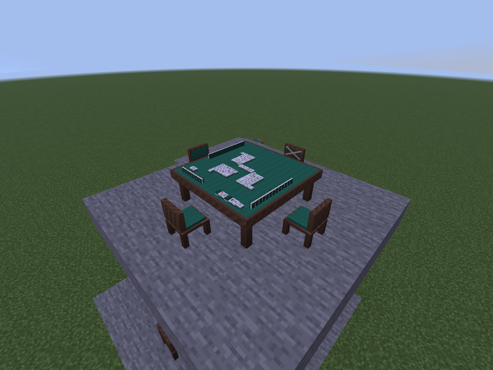

# 大桌公开牌面展示

用户于2026-10-17确认分步实现：本批在3×3大桌显示牌河、副露、宝牌指示、三麻拔北和暗手牌背，附近玩家无需打开界面即可观看；自己的手牌仍在原手牌界面查看。旧单方块桌保留界面入口。本页记载`0.0.10-dev`公开牌面步骤；后续静态牌墙与指示牌归位见[牌墙说明](TABLE_WALL.md)，摸打动画继续留后续。

后续`0.0.12-dev`已加入[桌面基础动作](TABLE_ANIMATIONS.md)，公开消息升级为`table_display_v3`，新增有界的逐次公开步骤；本页原有范围、隐私和生命周期继续适用。同步间隔仍为5 tick，演出不改变界面或服务器裁决时点。

后续方向更新（2026-10-18，0.0.13-dev已接入）：用户明确要求本人直接看桌面手牌、观战者看全员手牌，不做旁观防泄密机制。下文“暗手只发数量／只显示牌背”描述仍是`0.0.12-dev`当前实现；0.0.13-dev另增按参与／观战身份生成的手牌视图，见[坐席与桌面操作](IMMERSIVE_TABLE.md)，原匿名公开消息与新手牌视图分开。

## 已确认摆法

- 每家牌河每行6张，向本人一侧续排；立直宣言牌横放，被鸣走的牌从桌面移走，后续牌补位。宣言牌被鸣走时，下一张实际留河牌横放；界面仍保留完整舍牌历史与被鸣标记。
- 吃／碰／明杠按提供者实际椅位方向横放被鸣牌；加杠把准确的第四枚叠在原横牌上，不能按牌ID大小猜。暗杠两端盖牌，中间两枚朝上，有赤五时保留在可见的中间位置。
- 暗手只按公开张数排列无牌面模型，两面均不含图案，绕到椅后也看不到暗手。桌面模型不包含真正暗手ID，不从玩家背包取牌，不生成可拾取牌实体。
- 四麻按桌子朝向依次映射四边；三麻跳过空椅子。此处是显示位置，不把世界方向当作席风，轮庄不移动玩家。布局失效期间沿用最近有效显示位置，牌局的暂停／修复／确认流程沿用桌椅规则。

## 同步与渲染

`TableDisplaySnapshot`是独立公开数据：只含暗手数量、已保留牌河、声明组与鸣牌来源、已公开指示牌、已拔北及暂停／终局状态。`0.0.11-dev`新增活牌数，补牌次数由公开杠／北计数推得，指示牌在墙上只显示一次。服务端适配器只接受无私人手牌和动作选项的旁观视图，不复用某位参与者的私有快照。加杠身份由规则核心已接受的声明历史提供只读查询；不改规则裁决、旧归档格式或指纹。

当前每5个服务端tick检查一次，在同维度、距离桌心32格以内且正在跟踪所在区块的玩家中同步。每人最多展示最近64张活动大桌；只在公开内容或可见桌集合改变时发包。关闭界面、未入座或旁观模式不影响接收；退出范围、停止跟踪、回大厅或破桌会清除显示。更新和删除使用连接内递增序号，旧数据不能把已清掉的牌重新显示出来；断线重置，跨维度清显示但保留序号顺序。

客户端沿用已许可的37种牌面与共用立体模型，另生成一个只用于渲染的无牌面模型；没有第38种玩法牌。布局是确定性纯几何计算，使用世界渲染的提取／提交两阶段：先读取公开状态、模型与环境光，再提交帧内数据，不在提交阶段读取可变世界。

正常小局结算和整场结果保留桌面公开牌；下一局统一替换，回大厅清空。正常停服／重开仍从既有牌局存档重建公开数据。首次载入时若无法确定三麻空椅位置，则待椅位修复后再重建显示；已有牌局不会因此清除。

## 验证状态

实现位于`codex/tabletop-display`、开发版本`0.0.10-dev`。最终完整构建、23套规则／2,369,584断言、67项服务端测试和实际TCP客户端回归通过。跨维度快速往返改为事件触发重新同步；未入座旁观、范围进出、终局保留、重连、回大厅与破桌清空均有实际运行证据。三麻正常停服重开后，已成立拔北与暂停公开牌面也经实际客户端核对，详见[验证记录](VALIDATION.md)。人工长期手感另计。

布局展示夹具与真实牌局要分开记录：测试总览可同时摆放吃、碰、明杠、加杠、暗杠、立直横牌与拔北，目的是检查实际模型与空间布局；它不代表规则引擎在同一小局中实际成立了所有这些动作。真实旁观测试另由合法摸打产生牌河与鸣牌，未入座的TCP客户端接收并核对公开快照。

[真实四麻旁观](images/tabletop-live-four.png)、[真实终局保留](images/tabletop-live-result.png)。以下是三麻布局测试场景，使用真实世界渲染器，没有改写服务器牌局：

