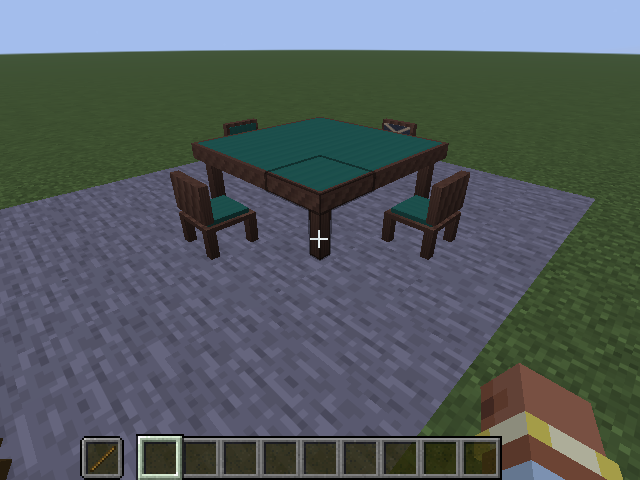

# 桌椅与多方块设计

日期：2026-10-17。**用户已确认并已实现大桌方案与椅子失效暂停方案，版本`0.0.8-dev`。** 前置可玩检查点`v0.0.7-dev`使用单方块麻将桌与大厅人数按钮；新桌使用独立标识，不覆盖旧桌或重新解释旧牌局。前置成果见[三麻操作](THREE_PLAYER.md)与[验证记录](VALIDATION.md)。

## 已确定的方向

- 实体麻将桌配合手牌操作界面，服务器继续负责规则、点数与私密信息。
- 四把普通椅子对应四麻；三把普通椅子加一把名为“空椅子”的方块对应三麻。其他布局不能激活结构。“空椅子”需要在外观上明确区分。
- 按小步骤加入普通桌、牌具和自动桌，之后才是NPC、探索、剧情与维度。
- 现有自动分配座位约定继续适用。几何方位与东南西北的牌局座风是两件事，连庄／轮庄不搬动玩家。

## 已确认的尺寸与摆放

用户选择3×3桌面，连同四个椅位最小水平外框5×5，为后续牌墙、牌河、副露及宝牌展示留出空间。下图只表示水平占地，桌子和椅子的高度仍按家具制作。

大桌俯视图：

```text
· · 椅 · ·
· 桌 桌 桌 ·
椅 桌 中 桌 椅
· 桌 桌 桌 ·
· · 椅 · ·
```

三麻时将任意一个规定椅位换成“空椅子”。所有椅子同层、朝向桌心；空位、斜放、背向、两把以上空椅子均不满足布局。图中的“·”不是结构成员，可以摆周边装饰；四个固定椅位之外的椅子不参与本桌人数计算，也不能代替缺失椅位。

用一件大麻将桌物品放置完整3×3桌体，所点地面的上一格是桌心：空间不够则整体不放置，不覆盖已有非可替换方块；拆除任一桌体部分清理其余部分，总共最多掉落一件桌子。椅子单独放置／掉落，放下时朝玩家面向的方向。“空椅子”是独立方块与物品，不是玩家离座后自动变成的状态。

## 外观与资源



第一套普通家具沿用现有深木框与绿色桌布，采用适合Minecraft的块状模型和原创像素材质；自动桌之后另做机壳、升牌与电子显示。参考当前[原创资源说明](ASSETS.md)。

- 普通桌：深木外框、低反光绿布，桌缘与桌面分层，四边留出将来放置牌具的位置。
- 普通椅子：配套木架与绿色坐垫，朝向从靠背即可辨认。
- “空椅子”：保留相同木架，改用深灰座面与浅色交叉纹，靠背加明显标记；同时靠图案和颜色区分。
- 第一批先完成静态模型、碰撞与交互入口。洗牌、升牌、掷骰与逐张牌墙动画在后续步骤处理。

本稿不提议更换手牌界面或引入美术依赖。身体实际坐下所需的乘坐实体／相机行为另行设计，不把打开界面等同于已实现坐姿。

## 大厅与已有牌局兼容

新结构由四个固定椅位识别三麻／四麻，大厅展示识别结果；赛制仍由初始东位选择，入座仍自动分配。布局有效且人数满足才允许开局，右键桌体任一部分进入同一大厅。预留的“空椅子”不接受参与者。

现有单方块桌与牌局保留原入口和人数按钮，不在加载时静默扩大桌体、迁移座位或改变人数。大桌使用单独方块标识`riichicraft:large_mahjong_table`；椅子为`riichicraft:mahjong_chair`和`riichicraft:empty_chair`。这一开发步骤先提供创造栏和`/give`入口，合成配方留到生存获取阶段，不引入旧桌转换或归档迁移。

用户已确认结构损坏后的行为：

- 未开局：布局失效则禁止开局并清准备；已有四人不能因换成三麻布局而自动踢人。
- 活动牌局／局间：椅子缺失、转向或被换成不同人数布局时暂停，保留原人数、参与者、牌山和账本；恢复成原人数的有效布局后，按现有全员确认流程继续。
- 终场：保留已经结算的点数与结果，不因椅子变化重新结算。
- 桌体破坏：沿用破桌终止规则。正常保存／卸载／停服沿用[现有存档边界](PERSISTENCE.md)。

不会把椅子失效当作破桌，也不会因有效布局改为另一人数而改写正在进行的牌局。

## 实施范围与验证

1. 尺寸、外观、布局与失效处理已确认，模型与放置交互已加入。
2. 原创桌／椅／空椅子模型与材质、注册、四朝向、放置与掉落已加入；服务端回归覆盖空间不足时不产生半张桌、九种部件破坏不重复掉落。
3. 服务端结构识别、同桌入口与人数约束、存档兼容和椅子失效／修复已接入；含已加载跨区块结构与不强载查询回归。
4. 实际客户端执行鼠标放桌、按椅位入座、暂停与同世界正常停服重开回归，截图保留；真人长期体验与坐姿手感不由自动化代替。
5. 之后单独设计麻将牌／牌盒、点棒、骰子以及世界桌面显示，不在本批提前加入自动桌、NPC或新维度。

完成状态与实际验证以[验证记录](VALIDATION.md)为准。静态文档检查不能当作多方块功能验证。

开发版获取方式：

```mcfunction
give @s riichicraft:large_mahjong_table
give @s riichicraft:mahjong_chair 4
give @s riichicraft:empty_chair
```

普通生存拆除任一已加载桌体部件只掉一件桌子，创造拆除不掉落，原生爆炸沿用原爆炸上下文结算且不会重复掉落。对无人区仅加载桌片的指令拆除，不强载其余区块；遗留部件重新加载后检查并清理，不补发物品。椅子以独立物品掉落。

桌椅`0.0.8-dev`阶段未含配方、实际乘坐实体或世界牌具；后续`0.0.9-dev`加入[首套麻将牌](MAHJONG_TILES.md)，`0.0.10-dev`加入[大桌公开牌河／副露等展示](TABLETOP_DISPLAY.md)。牌墙、动作动画、生存获取和自动桌仍留后续。
