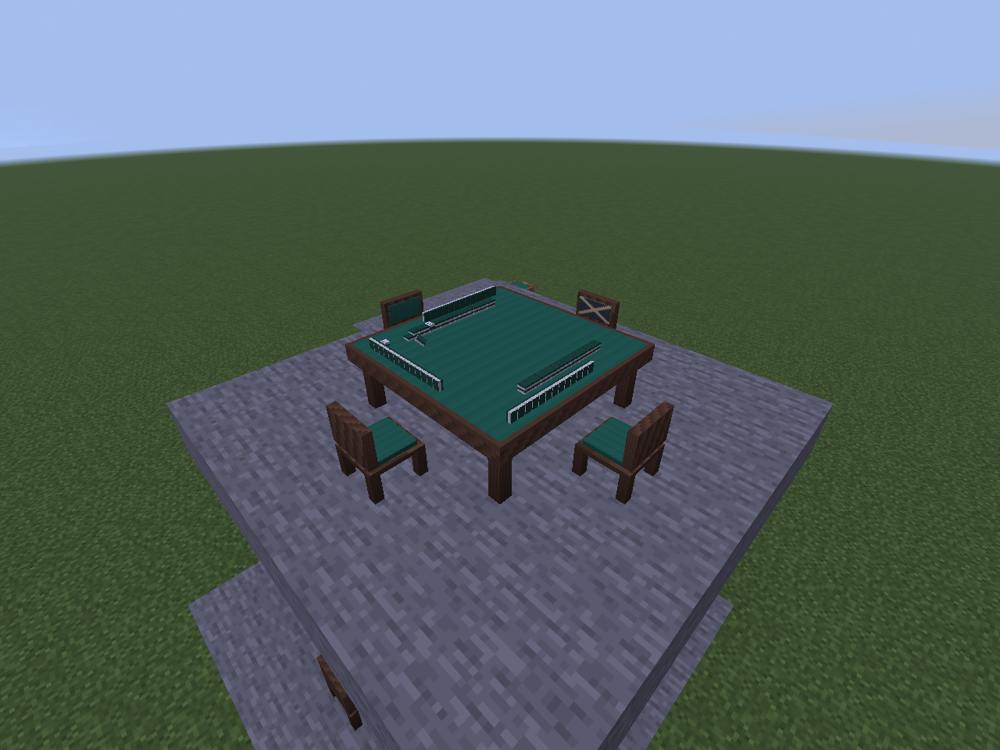

# 桌面基础动作动画

日期：2026-10-18。状态：**用户已确认完整基础动作范围与A短促节奏，已接入`0.0.12-dev`**。基于已完成的[静态牌墙](TABLE_WALL.md)与[公开桌面](TABLETOP_DISPLAY.md)，不修改雀魂三／四麻规则、合法动作、响应流程、计分、座位或存档生命周期。

## 玩家能看到什么

建议首批完成桌面基础动作：摸牌、打牌、吃碰、杠、三麻拔北及宝牌翻面。牌沿桌面上方的小弧线移动，落位干净，不加入夸张弹跳或发光。原有手牌界面、选牌和确认按钮照常使用，本步只改变世界里的桌面表现；旧单方块桌保留界面入口。

| 动作 | 建议表现 | 必须保留的边界 |
| --- | --- | --- |
| 普通摸牌 | 从准确的活牌位置取一张牌背，移到摸牌者暗手一侧 | 只表现牌背，不发送或短暂显示隐藏牌面 |
| 打牌／立直宣言牌 | 从本人一侧统一出牌位置移入牌河；立直牌落位时横放 | 不用他人的私有手牌顺序定位起点；牌河与最终横牌位置沿用现有摆法 |
| 吃／碰 | 已被鸣走的牌从提供者牌河移到鸣牌区，其余已公开组成牌由鸣牌者一侧入位；原牌河补齐空位 | 只有鸣牌实际成立才演出；保留提供方向、赤牌及被鸣标记 |
| 大明杠／暗杠／加杠 | 成立后声明组入位；加杠准确第四枚叠到原横牌上；随后从岭上正确位置补一张牌背 | 暗杠两端仍盖牌；被抢杠时不演出“杠已完成”或补牌 |
| 三麻拔北 | 成立的北移至拔北区，再从共用补牌端取一张牌背 | 被抢北时不把北放入已拔区、不补牌；不会提前翻已有延后杠宝 |
| 宝牌翻面 | 已公开的指示牌在王牌原位翻面 | 严格跟随核心实际公开时点，不因客户端动画先后新增宝牌 |

取岭上与活牌尾转入王牌是两件事。沿用用户确认的“尾牌原位划入保留区”，本步不把尾牌搬到岭上空位；其保留身份更新，但没有额外搬运动画。首枚岭上仍不预先放下，取牌位置遵循当前已验证的上下层映射。

开局直接显示已经完成配牌的桌面。洗牌、逐轮配牌、掷骰、自动桌升降、角色手臂／坐姿、和牌者摊手、点棒、音效及粒子均留后续设计；不把这些一并加入首批。

## 节奏的两个候选

| 候选 | 单段移动的首版目标 | 观感 |
| --- | --- | --- |
| A：短促（建议） | 约0.20～0.35秒 | 低弧线、迅速落位，快速对局时不容易积压 |
| B：舒缓 | 约0.40～0.60秒 | 移动更容易看清，多段补牌演出更长 |

一次动作可能有多个阶段，例如“北入拔北区→补牌”，不是整次动作必定只持续一段。具体曲线和小幅角度在原生渲染中微调；首批不新增设置界面。这里只确定默认观感，不让动画速度改变游戏规则或响应时间。

## 操作与中断原则

这些原则落实现有[规划](PLAN.md)关于响应时间与动画分离的要求：

- **服务器立即裁决，界面立即显示最新合法动作与结果；不等动画播放结束。** 不增加演出确认包、强制等待或新的倒计时。动画时长不计入任何未来响应计时。
- 同一个已成立动作中的演出按正确次序组织；例如吃碰之后不演普通摸牌，杠／拔北补牌取正确的岭上端。多个玩家快速操作时只保持短队列，明显落后便收束到最新状态，不积压数秒旧对局。
- 暂停时将未完成动画收束到已成立的准确桌面，不把牌永远冻结在半空；恢复后只演新动作。和牌／流局也收束为终局桌面并按原约定保留，不改点数和结果时点。
- 首次靠近、重新进入范围、跨维度返回、断线重连、区块重新载入或正常停服重开时直接显示当前状态，不倒放或补播历史动作。
- 回大厅、破桌、明确终止或切换到下一小局后清理旧动画；旧包、旧局事件不能把已经清空的牌重新带回来。

## 同步设计与隐私

现有服务端每5 tick同步公开桌面最终状态。在这个间隔内可能已经发生多次合法动作，因此仅对比两张最终快照不能可靠分辨动作的数目和顺序。

已在**已接受动作**的服务端适配处记录公开演出步骤，每步保存有公开变化的前／后快照，以单桌流UUID和递增编号排序，最多保留16步。只读当前牌桌，不为一次动作重建其他桌子的公开视图。新消息`table_display_v3`按观察者已知基线发送连续后缀；公开最新快照继续作为最终正确状态。它不是规则归档或客户端请求的回放，尚未成立的吃碰杠／拔北没有完成动画；若声明只公开上一次延后指示，则只有该次真实翻面。

每个步骤只含公开数量、牌河、声明组、北、指示与墙位计数；运动来源由这一个逐次变更投影，不能从合并后的最终状态虚构遗漏动作。他人手牌、牌山顺序、随机种子、隐藏表／里宝牌仍不进入网络。暗手都使用无牌面的模型；新公开的牌只使用匿名牌背位置作出牌起点，不对应真实私有排列。墙用位置键、公开牌用其已公开ID、暗手用席位与匿名槽位，保证被鸣的准确一枚从原牌河移动、加杠准确第四枚叠放。

演出事件不持久化，恢复归档仍以原规则状态重建静态桌面；新运行流或新小局建立新的演出基线。首次进入的观察者只收当前状态，已有观察者才按其已知基线接后续事件。缺少连续事件、队列超界或更新已经落后时直接使用最新快照，不猜测丢失动作，也不向服务器索取隐藏数据。

客户端用独立时钟计算过渡，移动0.24秒、摸牌0.26秒、翻宝0.22秒，多段依次排列；待播总时长超过1.2秒则直接收束。每帧只提交不可变模型与姿态，沿用现有渲染抽象，无新增依赖。每个终点只提交一个模型，不叠加一份静态目的牌，结束姿态精确等于`TableTileLayout`。`TileMotion`可以脱离Minecraft编译，`TableAnimationPlayer`可注入假时钟逐帧验证。

## 确认后实施与验证

1. 先实现可用假时钟驱动的演出状态机：顺序、重复／旧事件拒绝、每帧单实例、30／60／144帧下同一终点、快进收束、暂停和换局清理。组合补牌、延后翻宝、被抢杠／抢北只按实际成立分支生成事件。
2. 加入有界公共事件消息及服务端记录，验证每个集合分配上界、无私有牌ID、越权／失败动作不产生演出；同5 tick内连续操作也保留正确顺序，观察者初次加入不补演。
3. 接世界渲染，保存中途帧与结束帧。检查暗手任何角度无牌面、运动牌不重复、北与副露不撞墙，以及普通牌／赤牌、横牌、暗杠和补牌端位置。
4. 实际客户端／专用服务器回归进出范围、快速跨维度、重连、暂停／全票继续、终局与正常世界重开；静态最终布局与上一检查点一致，原四模式继续可玩。
5. 更新验证记录并保存开发提交；离线、实际Minecraft运行、代理看图及人工长期观感分开报告，不要求用户为可自动完成的验证反复进游戏。

当前分支`codex/table-animations-design`、版本`0.0.12-dev`。25套独立测试与74项服务端测试已通过；首轮真实客户端回归通过，同一同步间隔内两次公开变化均收到，并确认最新快照到达时世界模型仍处于运动姿态。最终回归、产物与截图见[验证记录](VALIDATION.md)。人工长期观感和手感另计，原生截图中的专用布局输入不冒称真实牌局完成了对应的杠或拔北。

[真实TCP现场](images/animation-live-four.png)记录实际客户端；以下是固定在拔北补牌中途的原生渲染测试帧，用于清楚检查运动姿态，不是修改过的游戏截图，也不改写服务器牌局。

[拔北补牌终点](images/animation-kita-end-layout.png)、[暗杠翻宝中途](images/animation-kan-mid-layout.png)、[暗杠补牌终点](images/animation-kan-end-layout.png)。
