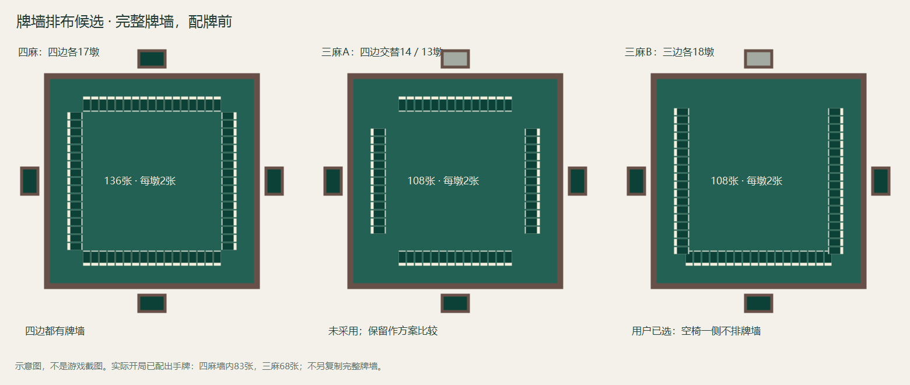
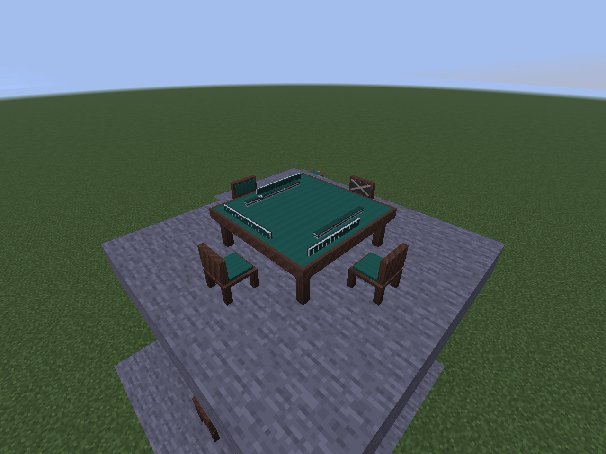

# 静态牌墙与王牌

日期：2026-10-18。状态：**用户已确认下述静态范围及三麻B方案，已接入`0.0.11-dev`**。基于已完成的[公开桌面展示](TABLETOP_DISPLAY.md)，本步不改雀魂三／四麻规则、洗牌、配牌、起家或存档生命周期。

本页记录静态墙检查点；后续`0.0.12-dev`沿用相同终点和取牌位置加入[基础动作动画](TABLE_ANIMATIONS.md)，尾牌仍原位划入王牌。下文“不做动画”描述的是本页原步骤，不覆盖后续已确认范围。

## 已确认范围

先实现随牌局准确变化的静态牌墙：普通摸牌后少一张，杠／拔北补牌后同时更新岭上端和活牌尾，暂停、重连、正常重开后保持相同位置。先把每一张“应当存在在哪里”验证清楚，再做摸打、搬牌、掷骰与自动桌升降动画。

- 继续使用3×3桌面和现有牌体，手牌／副露在外圈，牌墙在中圈，六张一行的牌河在内圈。保留既定的立直横牌、鸣走补位和鸣牌方向。
- 宝牌指示牌放到王牌对应的上层位置；不再在桌心重复摆同一张实物。手牌界面的宝牌信息照常保留。
- 未公开牌墙只显示无图案牌背。终局也不自动翻开剩余牌山、未公开表宝牌或里宝牌；本步不新增终局公开信息。
- 初次实现使用相对桌子朝向固定的开口与取牌路径，不新增掷骰决定开口或起家。它是显示映射，不参与随机牌序和和牌裁决。
- 补牌后让活牌尾原地划入王牌保留区，不把它瞬移到已取走的岭上空位。14枚保留牌不必永远排成完整的7墩，边界可能穿过一墩的上下层；后续动画沿用这些物理位置。
- 本步直接显示动作完成后的状态，没有飞牌、翻牌过渡或等待动画才能操作的延迟。已有暂停／恢复／终局保留流程不变。

## 已确认的三麻排墙方式

以下均为Riichicraft外观候选，不宣称是雀魂客户端已经核实的实体排墙。墩指上下叠放的两张牌。

| 方案 | 完整洗好、尚未配牌的牌墙 | 取舍 |
| --- | --- | --- |
| 四麻基准 | 四边各17墩，共136张 | 四边都有牌墙 |
| 三麻A（未采用） | 四边依次14／13／14／13墩，共108张 | 保留作方案比较，不实施 |
| 三麻B（用户选择） | 三个有人椅位各18墩，共108张；空椅一侧不排 | 空椅一侧完全留空，三条墙稍长；取牌路径跨过这一空边 |

图只比较**配牌之前的完整牌墙**和椅位，不是实际开局截图。进入已开局场景时，已经发到手里和庄家首摸的牌都从墙上移除：四麻墙内剩69活牌＋14保留牌，三麻剩54活牌＋14保留牌，不能又画一副完整136／108张牌。

## 取牌、补牌与指示牌必须满足的约束

这些是已有规则与数据的显示约束，不把已确认的三麻补牌8次重新交给用户裁定。

| 动作 | 玩家取得的牌 | 墙上应如何变化 |
| --- | --- | --- |
| 普通摸牌 | 活牌头一张 | 对应上／下层位置消失，活牌数减1；一般每墩先上后下 |
| 四麻杠成立并补牌 | 下一枚岭上 | 岭上对应位置消失；活牌尾一张仍留在原处，但改属王牌，活牌数减1；总保留枚数仍为14 |
| 三麻杠／拔北成立并补牌 | 下一枚共用补牌 | 同上；已补数共用0～8，不能将初始王牌区扩大为18张 |
| 抢杠／抢北成立 | 被抢的声明牌 | 该次补牌不发生，墙不缩；不能提前消耗一个岭上位置 |
| 翻新杠宝 | 已有对应位置的牌 | 该张在原位改为已公开牌面；不是从墙外额外添加一张 |

补牌要区分两端：玩家从岭上端取得一张；被划入保留区的是活牌山尾的另一张。按每墩先上后下的排法，完整末墩的末张是下层；下层已划入保留区后，下一次尾牌可能是该墩上层。因此不能把两种动作都实现成“固定取下面那张”。

三麻初始14张保留牌包含8个补牌位置和当时已进入保留区的指示位置；后续部分指示牌随着边界推进才进入保留区。只根据规则核心**已经公开的指示数量**翻牌，不能由补牌次数自行推断：拔北不新增指示，明／加杠有延后翻宝时点，拔北也不提前翻此前延后的杠宝。

## 实现边界与数据设计

`TableWallLayout`是可脱离Minecraft编译的纯位置投影，不改已接受动作、计分或旧归档格式。公开快照新增活牌数，补牌次数直接由已经声明的杠数＋已拔北数推得；不再向规则核心或归档添加冗余字段。新消息名`table_display_v2`避免把旧消息布局当成新格式读取；客户端和服务端都更新至`0.0.11-dev`后显示本版桌面。

普通取牌按各墙的上、下层依次展开；补牌按末端墩上→下、再向内下一墩取，本版不预先把第一枚岭上搬下。四麻第一张指示在补牌端数第三墩上层；三麻在第五墩上层，后续指示沿上层向活牌尾方向延伸。逻辑存储到实体位置采用固定置换，纯位置编号不含牌身份。种子、牌序、未公开表／里宝牌及墙内隐藏物理ID均不发给客户端。

物理格位与核心存储索引分开。特别是四麻`deadTiles()`会把活牌尾身份放进已用补牌槽，不能把该存储槽误当作实际搬牌位置；三麻的动态保留边界也不能按“四麻10指示＋4补牌”的固定图套用。恢复时从已保存的小局和固定映射重建，不重新随机开口。

实际布局保留外圈手牌／副露，墙的中心距桌心16个模型单位、缩放0.7；拔北排在墙与本人外圈之间。长牌河仍每行6张，内圈按行数缩放以避开牌墙，不扩大3×3桌体。测试覆盖全部四个朝向、四个空椅位置、长牌河及多组副露，比较完整立体包围盒，不能仅靠俯视图判断互不遮挡。

## 实现与验证顺序

1. 先做不依赖Minecraft的墙格位投影，分别对四麻／三麻的普通摸牌与补牌交错验证：墙内实物数＝活牌数＋14；牌墙与持牌／牌河／副露／拔北的物理身份守恒；翻牌不新增实物；同一状态恢复映射相同。
2. 穷举有意义的杠／拔北补牌顺序，覆盖三麻8次补牌、三／四麻活牌耗尽前后的边界、延后翻宝、未成立的抢杠／抢北声明。现有规则测试继续负责是否合法，显示层不另写一套裁决。
3. 接公开同步与世界模型，检查无隐藏牌面／ID、消息边界和观察者进出。实际服务端／客户端覆盖暂停、跨维度、重连、终局和正常世界重开后的墙形一致。
4. 保存原生截图，分别记录真实牌局和专用布局场景；离线检查、游戏运行与人工观感分开报告。通过后再进入动作动画设计。

## 当前状态

用户已确认静态范围并选择三麻B；当前开发版本`0.0.11-dev`，在`codex/table-wall-design`实现。比较图仍是设计图，已标出用户选择B。新增验证的执行结果记入[验证记录](VALIDATION.md)，既有桌面测试不作为牌墙验证证据。

新增独立墙形验证3,289,179断言、服务端69项测试与实际客户端回归通过。正常世界重开后，三麻已拔北牌局的墙、指示及全部公开模型坐标一致。截图中[四麻开局](images/wall-opening-four.png)、[四麻实际摸打](images/wall-live-four.png)和[终局保留](images/wall-result-four.png)来自真实引擎牌局；三麻下图为原生渲染器的专用布局输入，未改写服务器游戏，不冒称同局发生图中全部动作。

[三麻鸣牌／拔北布局总览](images/wall-melds-three-layout.png)。人工长期视觉与操作体验另计，本版没有飞牌、洗牌、升牌或掷骰动画。
