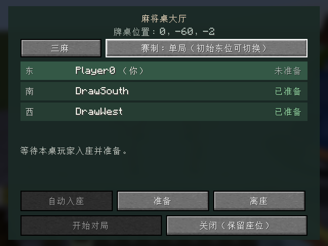
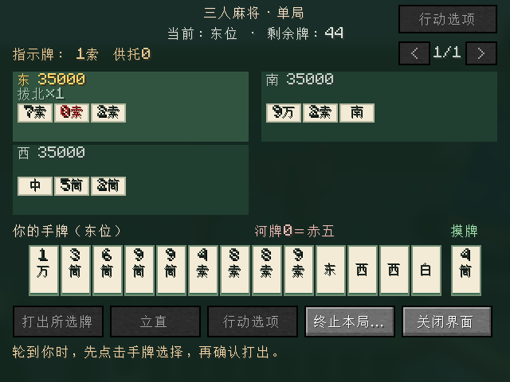
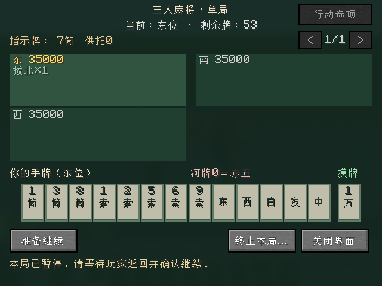

# 三人麻将

三麻自`0.0.7-dev`接入；当前开发版本`0.0.10-dev`。沿用实体麻将桌与手牌界面，支持三人单局、东风、半庄；规则来源和用户裁定见 [三麻规则表](THREE_PLAYER_RULES.md)，独立接口见 [三麻核心](THREE_PLAYER_CORE.md)，最终执行证据见 [验证记录](VALIDATION.md)。

## 入座与赛制

以下人数按钮适用于旧单方块桌。新大桌由三把麻将椅加一把空椅子识别三麻，所有椅子朝桌心，界面不提供人数切换；赛制与其他操作相同。

1. 放桌、右键打开大厅，自动入座。初始东位可点“三麻／四麻”切人数，点赛制切单局／东风／半庄。
2. 切人数或赛制清空所有准备。切人数时压紧空座、保留已有玩家的相对顺序；已有四人时禁止切三麻，提示一人主动离座，不自动踢人。
3. 三麻只有东／南／西三个席位；三人全部准备后由初始东位开始。新场各35,000点，东风／半庄目标40,000，最大延长南3／西3；单局结算后即可回大厅。
4. 开局后不能改变人数或赛制。东风／半庄小局结算后各自确认，三票齐才下一局；缺席清续局票，关闭界面保留对局。

## 摸打与拔北

108枚物理牌，去二至八万，赤五筒／赤五索各一；庄家首摸后54活牌。没有吃，保留碰／杠／立直／自摸／荣和。一般操作和分页沿用 [四人单局](SINGLE_ROUND.md)。

在自己的摸牌操作阶段打开“行动选项”菜单，可自愿拔出一枚自持北；每次先处理另外两家的抢北，再补一张。北可以留在手里正常组牌，碰后必须先弃牌、不能直接拔北。已立直仅可拔刚摸到的北；无活牌／无补牌容量／多人第四杠待弃牌时不提供拔北。

公开面板显示各家“拔北×数量”，结算另列拔北番；每枚北仍保留物理身份。已成立拔北不占面子、不添符、不破门清，本人拔北不记入舍牌振听；放过他家结构完成北仍按同巡／立直振听处理。宝牌或拔北奖励不能代替役。

补北和牌可以有岭上；抢北可以是普通形、七对子或国士，但不增加抢杠役，仍须有役且不振听。被抢北不成立、不补牌、不新增拔北数，保留宣言前有效的一发；无人和才正式成立并打断一发／首巡。已有延后杠宝不因拔北提前翻，按已确认的弃牌或下一杠时点处理。

## 结果与恢复

- 自摸按实际两付款家计算，不向虚构北席收费。每本场荣和200、自摸两家各100；不听罚符共2,000。流局满贯要求门清，合法暗杠和拔北允许。
- 单局或整场终局保留结算／牌河，任一参与者可带全桌返回大厅并取消准备；新场才重置35,000。终局掉线不撤销点数，主动终止仍二次确认。
- 活动局缺席时暂停；三人回桌确认后继续。正常保存／停服／区块卸载保留牌局，恢复先暂停，局间清续局票，终场保留。三麻核心独立归档，四麻旧档继续可读；损坏记录保留并阻止覆盖，异常崩溃仅保证最近成功保存。

当前仍无NPC、倒计时、自动拔北或桌面牌墙动画。`0.0.8-dev`另提供[3×3大桌与椅位结构](TABLE_AND_CHAIRS.md)：三把麻将椅加一把“空椅子”识别三麻；旧桌继续使用大厅人数按钮，不扩大旧桌或改写旧牌局。

自动化由一个真实TCP客户端与两名原生服务端测试玩家完成，具体结果见验证页；三位真人的长期视觉与操作手感验收另记，不由自动化代替。

`0.0.10-dev`大桌已加入[公开牌面与附近旁观](TABLETOP_DISPLAY.md)，包含三席暗手牌背和已拔北；开局、动作与恢复仍按本文流程。
